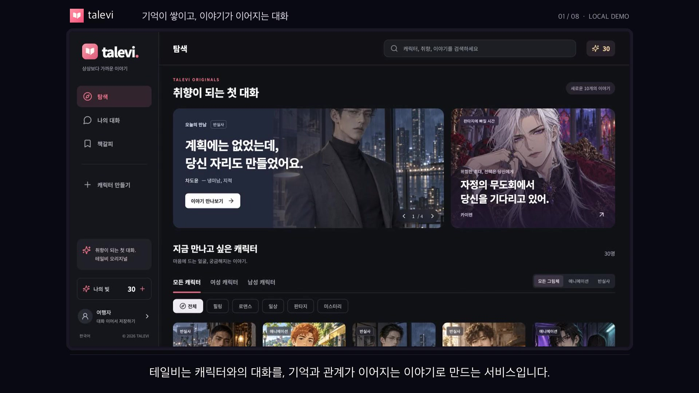
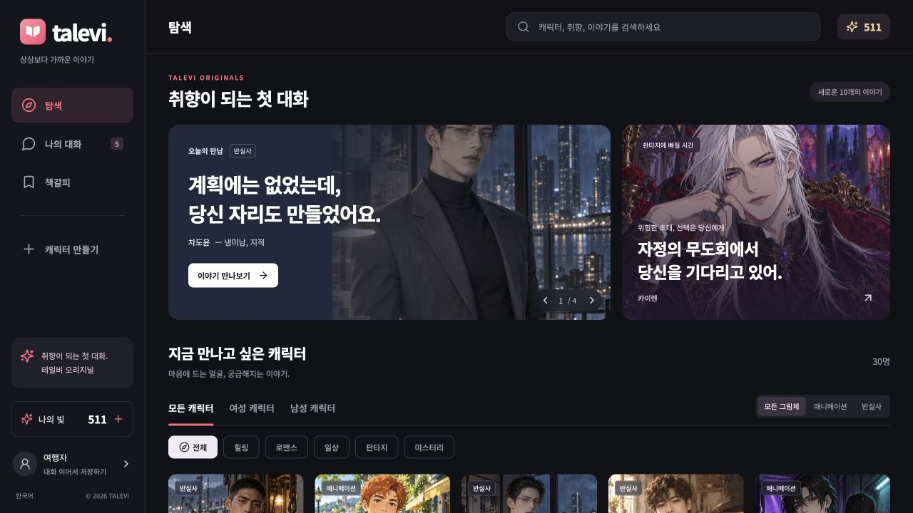
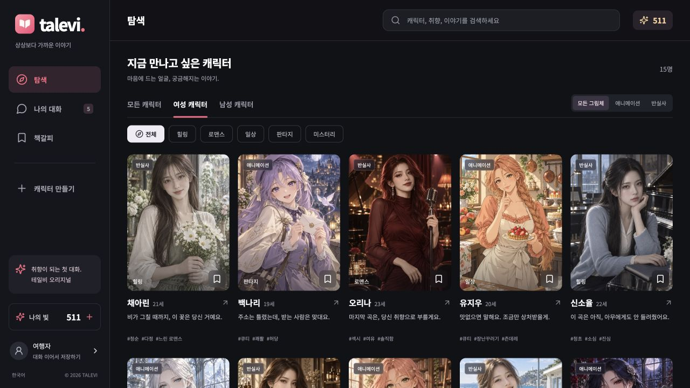
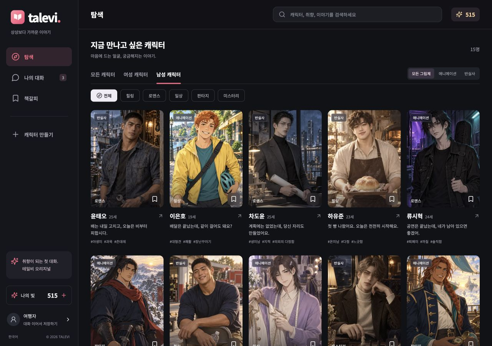
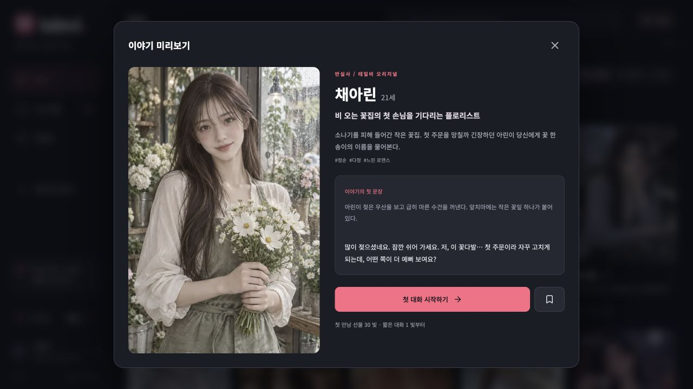
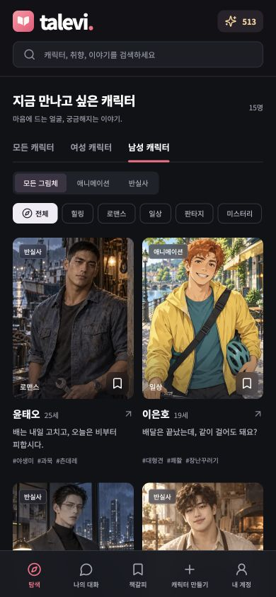
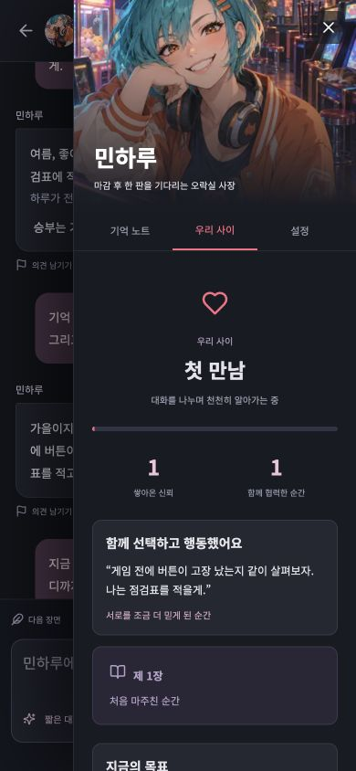
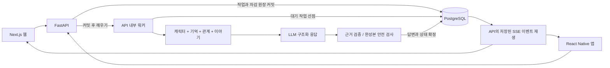

<p align="center"></p>

# 테일비 Talevi

**취향이 되는 첫 대화, 다음 만남까지 이어지는 기억.**

테일비는 30명의 캐릭터와 대화하며 기억, 관계와 이야기를 이어가는 한국어 AI 캐릭터 채팅 프로젝트입니다. Next.js 웹, React Native 앱과 FastAPI 서버를 구현했습니다. 사용자가 기억을 고치거나 과거 답변에서 분기할 때, 모델이 읽는 문맥과 저장된 상태를 함께 다루는 데 집중했습니다.

Next.js · React Native / Expo · FastAPI · PostgreSQL · OpenAI

[로컬 시연 영상](docs/demo/README.md) | [기술 설계와 문제 해결](docs/portfolio/ENGINEERING.md) | [최신 자동 검증](docs/portfolio/LATEST-VALIDATION.md) | [과거 유료 모델 평가 원문](docs/MODEL-EVALUATION-ARCHIVE.md) | [공개 범위와 권리](RIGHTS.md)

현재 **로컬에서 실행하는 개발 프로젝트**이며 공개 서비스 배포와 실제 결제 거래 검증은 보류했습니다. 개발과 이미지 제작에 AI 도구를 사용했습니다. 아래에서 구현 코드, 자동 회귀 검사와 과거 실제 모델 평가를 구분해 확인할 수 있습니다.

## 핵심 설계와 확인할 코드

| 문제 | 구현 | 코드와 검사 |
| --- | --- | --- |
| 이름을 고치면 같은 문장의 약속까지 사라짐 | 원본 대화는 보존하고, 모델 문맥에서 수정한 사실만 가림. 잠금과 삭제 표시를 자동 갱신에서 보호 | [기억 문맥](apps/api/yeoun/memory_context.py), [회귀 검사](apps/api/tests/test_quality.py) |
| 과거 장면에 이후의 기억과 관계가 섞임 | 턴 전후 체크포인트로 기억, 관계, 이야기와 설정을 복원. 재생성, 편집, 분기는 원본을 남기고 새 대화 생성 | [분기 구현](apps/api/yeoun/branching.py), [30명 복원 검사](apps/api/tests/test_branch_catalog.py) |
| 전송 결과를 모르는 상태에서 다시 눌러 중복 차감됨 | 요청 번호와 본문 지문, PostgreSQL 작업 큐와 원장을 연결. 같은 요청은 기존 결과 반환, 실패한 작업은 앱 크레딧 환급 | [API](apps/api/yeoun/main.py), [워커](apps/api/yeoun/worker.py), [원장 검사](apps/api/tests/test_billing.py) |
| 이름만 다르고 반응은 비슷한 캐릭터 | 30명별 말의 리듬, 감정 대응, 개인 과거와 관계 단계별 연기 지침을 프롬프트에 조합 | [연기 지침](apps/api/yeoun/personas.py), [실제 대화 평가](docs/portfolio/VALIDATION.md) |

2026-10-15 자동 검사는 **144개 통과**했습니다(API 107, 웹 11, React Native 26). 고정 응답과 모의 모델을 사용한 상태 및 오류 처리 검사입니다. 2026-10-10 실제 모델 평가의 **완료 응답 1,256건**은 별도 보존 기록이며, 최신 답변 품질이나 경쟁 서비스 대비 우위를 나타내는 수치는 아닙니다.

## 로컬 시연 영상

[](docs/demo/talevi-local-demo.mp4)

[MP4 영상 보기](docs/demo/talevi-local-demo.mp4) | [시연 구성과 촬영 기록](docs/demo/README.md)

**2분 43초의 데스크톱 웹 시연입니다.** 대사와 모델의 상태 제안은 2026-10-10 실제 유료 평가의 네 턴을 재생합니다. 기억 수정과 잠금, 체크포인트 분기는 현재 앱과 전용 PostgreSQL에서 실제로 처리했습니다. 새 모델 생성이나 응답 속도를 측정한 영상은 아닙니다. [상태 비교 결과](docs/demo/state-verification.json)

## 어떤 대화를 만들고 있나요?

“내가 좋아하는 음료를 기억해 주는 대화”에서 시작해, “함께 고른 선택 때문에 다음 장면이 달라지는 대화”를 목표로 합니다. 캐릭터는 외모와 직업뿐 아니라 말의 길이, 감정에 반응하는 방식, 자기 판단과 망설임을 다르게 갖습니다.

| 경험 | 구현한 기능 |
| --- | --- |
| 취향에 맞는 첫 만남 | 성별, 그림체, 장르 필터와 검색, 책갈피, 첫 장면 미리보기 |
| 서로 다른 30명의 인물 | 여성 15명 / 남성 15명, 반실사 15명 / 애니메이션 15명, 모두 성인인 가상의 인물 |
| 내가 고칠 수 있는 기억 | 이름, 분류별 취향, 약속을 저장하고 직접 수정, 잠금, 삭제 |
| 이유가 보이는 관계 변화 | 협력과 자기 공개, 갈등과 화해의 발언 근거를 관계 화면에 표시 |
| 앞선 선택을 잇는 이야기 | 현재 목표와 갈등, 선택, 결과, 미해결 사건을 다음 답변에 반영 |
| 대화를 계속하는 흐름 | 짧은 대화 / 이야기 모드, 답변 전달 상태, SSE 재연결, 실패 시 크레딧 환급 |
| 다른 선택으로 다시 시작 | 답변 재생성, 사용자 메시지 편집, 선택 시점의 상태를 복원하는 이야기 분기 |

분기만 만들 때에는 모델 생성과 크레딧 차감이 없습니다. 재생성, 편집 후 새 답변과 분기 이후의 대화에는 선택 모드의 크레딧이 적용됩니다. [복원 시점과 비용](docs/CHAT-BRANCHING.md)

## 화면으로 보는 서비스

### 1. 얼굴에서 시작해 이야기로 고르기

캐릭터마다 표정과 실루엣, 의상, 배경을 구분하고 카드에 첫 대화의 분위기를 담았습니다. 원하는 장르와 그림체를 함께 좁힐 수 있습니다.







### 2. 첫 메시지 앞에서 망설이지 않도록

인물의 소개와 이야기의 첫 문장을 먼저 보여 줍니다. 장면 안에서 바로 대화를 시작할 수 있도록 구성했습니다.



### 3. 이름을 바꿔도 함께 하던 일은 그대로

아래는 합성 테스트 대화입니다. 기억 노트의 이름을 `여름`에서 `가을`로 바꾼 뒤에도 음료 취향과 함께 하던 게임기 점검을 유지했습니다. 관계 패널에는 협력한 발언과 현재 목표를 표시합니다.


### 4. 작은 화면에서도 이어지는 탐색과 관계

<table>
  <tr>
    <td align="center"></td>
    <td align="center"></td>
  </tr>
  <tr><td align="center">캐릭터 탐색</td><td align="center">우리 사이와 이야기</td></tr>
</table>

캡처는 실제 로컬 웹 화면입니다. 탐색과 미리보기는 2026-10-12, 남성 목록과 모바일 탐색은 2026-10-09, 대화와 관계 화면은 2026-10-10 검증 기록입니다. 모바일 이미지는 반응형 웹이며 React Native 실기기 캡처가 아닙니다.

## 서비스 구조



| 영역 | 기술과 역할 |
| --- | --- |
| 웹 | Next.js App Router, React, TypeScript. 탐색부터 대화와 기억 관리까지 |
| 앱 | React Native, Expo. 공통 API 계약, 보안 세션 저장, SSE 수신 |
| 서버 | FastAPI, 비동기 SQLAlchemy. 인증, 대화, 기억, 작업 처리, 원장 |
| 데이터 | PostgreSQL, Alembic. 트랜잭션, 작업 선점, 이벤트 재생 |
| AI | OpenAI Responses. 캐릭터 문맥과 구조화 응답, 설정에 따른 모델 선택과 오류 시 대체 |
| 결제 | Toss Payments / RevenueCat 연동 코드. 실제 거래와 스토어 검증은 별도 |

현재 한국어를 지원하며 locale과 공통 계약을 분리해 다국어 확장을 준비했습니다. 다른 언어의 UI와 모델 품질 평가는 아직 구현 범위에 포함하지 않았습니다.

SSE는 **완성된 답변을 검수한 뒤 나눠 전달**합니다. 생성 중인 원시 토큰을 즉시 보여 주지는 않습니다. 기억은 구조화된 사실, 최근 대화와 최대 8개의 검증된 과거 원문 인용을 조합합니다. 현재 기본 설정은 두 대화 모드 모두 `gpt-6-sol`이며 분량과 지시를 달리합니다. 설계 이유, 문맥 한도와 복구 보장의 범위는 [기술 설명](docs/portfolio/ENGINEERING.md)에 정리했습니다.

## 검증으로 확인한 것

**2026-10-15 최신 자동 검증**에서는 고정 응답과 모의 모델로 상태 복원, 전송 복구와 실패 처리를 검사했습니다. 실제 PostgreSQL을 사용하는 API 107개, 웹 11개, React Native 26개가 통과했습니다. TypeScript, Ruff, Next.js 빌드, Expo iOS/Android export, 빈 DB의 전체 마이그레이션도 통과했습니다. Expo export는 네이티브 실기기 검증이 아닙니다. [실행 환경과 재현 방법](docs/portfolio/LATEST-VALIDATION.md)

아래는 **2026-10-10에 유료 API로 수행한 실제 모델 평가의 보존 기록**입니다. 이번에 30명 전체를 실제 모델로 다시 평가한 결과가 아닙니다. 합성 입력 검사이며 실제 이용자의 만족도나 경쟁 서비스 대비 승률을 나타내지 않습니다.

| 검사 | 결과 |
| --- | --- |
| 30명 기본 응답 | 240/240 완료 |
| 30명 각각 30턴 연속 대화 | 900/900 완료 |
| 압축 후 정정된 5개 사실 회상 | 30명 전원 회상 |
| 첫 만남 / 깊은 신뢰의 상태별 응답 | 60/60 완료 |
| 추가 검사를 포함한 완료 응답 | 1,256건 |

평가 중 압축 요청의 시간 초과가 한 번 발생해 저장된 결과를 보존하고 재개했습니다. 1,256건은 완료 응답 수이며 초안 재생성, 압축, 검사와 실패 요청을 포함한 총 유료 호출 수가 아닙니다. 관계 단계 검사는 상태를 직접 넣은 비교이며, 30턴 동안 자연스럽게 깊은 관계에 도달했다는 뜻도 아닙니다.

당시 엔진 응답 시간 중앙값은 짧은 대화 **3.74초**, 이야기 모드 **10.27초**였습니다. HTTP 대기와 브라우저 렌더링을 포함하지 않으며 최신 빌드의 속도를 다시 측정한 수치도 아닙니다. 완성본 검수가 지연을 늘리는 만큼, 품질을 유지하며 대기 시간을 줄이는 것이 다음 과제입니다. 측정 범위와 캐릭터별 결과는 [기존 모델 평가 문서](docs/portfolio/VALIDATION.md)에 정리했습니다.

초기 모델 비교, 100개 합성 메시지의 기억 실험, 개편 당시 24회 검사와 v11 이전 실패/재검증 기록도 삭제하지 않았습니다. [전체 유료 평가 자료 색인](docs/MODEL-EVALUATION-ARCHIVE.md)에서 원문을 볼 수 있습니다. 공개 준비 중 증거 126개 중 123개는 바이트 단위로 보존했고, 로그 3개의 로컬 경로만 가렸습니다. [보존 검증과 이력 정리](docs/HISTORY-REWRITE-2026-10-15.md)

## 프로젝트 범위와 다음 과제

기획, 화면과 로고, 캐릭터 설정부터 웹/앱/API, 프롬프트와 평가까지 포함합니다. 자동 검사에서 확인한 상태 처리 문제와 과거 실제 대화에서 드러난 기억 오류, 반복 표현을 수정해 온 기록을 함께 제공합니다.

독립적인 이용자 평가, 경쟁 서비스와의 동일 조건 비교, 수개월 대화, 운영 부하, 모바일 실기기와 결제사 실제 거래 검증은 남아 있습니다. 이메일 확인, 비밀번호 복구, 계정 삭제와 데이터 보관 정책도 출시 전 과제입니다. [상용 서비스 검토와 기능 우선순위](docs/CHAT-REVIEW-2026-10-15.md), [운영 준비 상태](docs/RUNBOOK.md)

## 코드와 개발 문서

| 경로 | 내용 |
| --- | --- |
| `apps/web` | Next.js 웹과 캐릭터/브랜드 자산 |
| `apps/mobile` | React Native / Expo 앱 |
| `apps/api` | FastAPI, 워커, 모델 어댑터, 마이그레이션, 테스트와 평가 도구 |
| `packages/contracts` | 웹과 앱의 공통 타입, 한국어 문구, API/SSE 처리 |
| `docs` | 조사, 설계, 검증 보고서와 합성 평가 증거 |
| `deployment`, `compose.yml`, `render.yaml` | 운영 구성을 위한 배포 파일 |

[전체 아키텍처](docs/ARCHITECTURE.md) | [실행과 운영](docs/RUNBOOK.md) | [30명 개선 보고서](docs/QUALITY-IMPROVEMENTS-2026-10-10.md) | [캐릭터별 연기 지침](docs/CHARACTER-PERFORMANCE.md) | [9개 서비스 조사](docs/RESEARCH.md) | [CI 실행 내역](https://github.com/kwakhyun/talevi/actions/workflows/ci.yml) | [공개 저장소 운영 방침](docs/PUBLISHING.md)

## 로컬 실행

Node.js 22 이상, Python 3.11 이상을 사용합니다. `db:start`는 설치된 embedded-postgres 패키지로 실제 PostgreSQL을 실행하고 로컬 개발 DB와 전용 테스트 DB를 만듭니다. 별도 Docker는 필요하지 않습니다. 검증한 환경은 [최신 자동 검증](docs/portfolio/LATEST-VALIDATION.md)을 참고하세요.

```sh
npm ci
python3 -m venv .venv
.venv/bin/pip install -r apps/api/requirements.lock
```

`.env.local`이 없으면 `.env.example`을 복사합니다. 아래 빠른 실행은 **키 없이 고정 예시 응답을 사용하는 체험 모드**입니다. 기존 비밀 파일을 덮어쓰지 않고, API 프로세스의 환경 변수로 모드와 빈 키를 지정합니다. 캐릭터별 실제 모델 품질은 위 유료 평가 원문에서 확인할 수 있습니다.

각 명령은 별도 터미널에서 실행합니다.

```sh
# 1. 저장소 루트 — 로컬 PostgreSQL
npm run db:start
```

```sh
# 2. API와 내부 워커 — 유료 모델 호출 없는 체험 모드
cd apps/api
../../.venv/bin/python -m yeoun.migrate
ENVIRONMENT=development DEMO_MODE=true OPENAI_API_KEY= \
  ../../.venv/bin/uvicorn yeoun.main:app --host 127.0.0.1 --port 8000
```

```sh
# 3. 저장소 루트 — 웹
npm run dev
```

웹: http://localhost:3000 / API 문서: http://127.0.0.1:8000/docs

실제 모델로 전환하면 유효한 공급자 키와 사용 가능한 모델 ID가 필요하며 비용이 발생합니다. 앱 실행, 모델 전환, 유료 호출 없는 테스트와 배포 구성은 [RUNBOOK](docs/RUNBOOK.md)을 참고하세요. 의존성, 로컬 DB, 비밀 설정과 빌드 산출물은 저장소에 포함하지 않습니다.

## 소스 공개 정책

전체 소스와 포트폴리오 자료는 [kwakhyun/talevi](https://github.com/kwakhyun/talevi) 한곳에서 관리합니다. 서비스 소개, 시연 영상, 기술 설명과 [과거 유료 검증 자료](docs/MODEL-EVALUATION-ARCHIVE.md)를 이 저장소에서 함께 확인할 수 있습니다. [권리 안내](RIGHTS.md)를 적용하는 소스 공개 포트폴리오이며 오픈소스 재사용 라이선스를 부여한 것은 아닙니다. 공개 서비스 호스팅은 계속 보류합니다.
