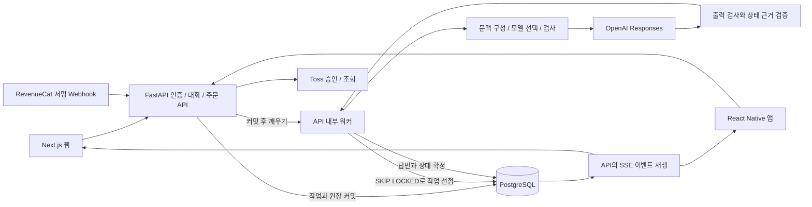

# 테일비의 구조와 구현 경계

2026-10-16 코드 대조 후 설명을 정리했다. 현재 실행 범위는 로컬이며 공개 운영 배포와 실제 결제 거래는 검증하지 않았다. 주요 설계 이유와 회귀 검사 경로는 [대화 상태와 복구 설계](portfolio/ENGINEERING.md)에 있다.

## 선택한 스택

- 웹: Next.js 16 App Router, React, TypeScript. 서버 API에 같은 출처의 `/api` 경로로 접근한다.
- 앱: React Native, Expo SDK 57. SecureStore에 불투명 세션 토큰을 보관하고 Expo fetch로 SSE를 읽는다.
- API: FastAPI, async SQLAlchemy, Psycopg. Python AI 생태계와 비동기 스트리밍을 그대로 활용할 수 있어 선택했다.
- 데이터: 실제 PostgreSQL. 로컬에서도 embedded-postgres로 별도 PostgreSQL 프로세스를 실행한다. 운영은 관리형 PostgreSQL 권장.
- 모델: OpenAI Responses 구조화 응답 어댑터. 완성된 대화와 근거가 있는 상태 제안을 한 요청에서 생성한다. 응답 모델은 gpt-6-sol, 과거 원문 선택과 필요한 안전 문맥 재검사는 gpt-5.4-mini다. 모델 ID는 환경 변수로 분리한다.
- 결제: 웹 Toss Payments 승인과 앱 RevenueCat 구매 알림을 처리하는 연동 코드. 서버 원장이 잔액의 기준이며 공급자와 연결한 실제 거래는 미검증이다.

그림의 워커는 API 프로세스 한 개 안에서 이벤트로 깨어나는 구성이다. 별도 프로세스 워커와 HTTPS 게이트웨이의 배포 파일도 있지만 클라우드 운영을 확인한 구성도는 아니다. 결제 경로는 모의 공급자 테스트까지 확인했다.

## 한 메시지의 처리

1. 웹은 HttpOnly 쿠키, 앱은 Bearer 세션으로 사용자를 확인한다. 토큰 원문은 DB에 저장하지 않는다.
2. `client_id`와 요청 본문의 지문을 비교한다. 같은 요청은 같은 Turn을 반환하고 다른 내용의 재사용은 409다.
3. 해당 대화와 사용자 행을 잠근 뒤 잔액을 조건부로 차감한다. Turn, 사용자 메시지, 차감 원장, active_turn과 직전 체크포인트를 같은 트랜잭션에 기록한다.
4. 워커가 `FOR UPDATE SKIP LOCKED`로 작업을 선점한다. 브라우저가 닫혀도 작업은 DB에 남는다.
5. 캐릭터 설정, 관계, 서사 상태, 확인 가능한 기억, 최대 8개의 이전 장면 인용, 최근 대화를 프롬프트에 조합한다. 52개 이상 쌓이면 이전 구간에서 원문 인용을 선택하고 최신 40개를 유지한다. 짧은/이야기 모드의 출력 상한은 각각 1,700/3,000토큰이며 상태 JSON도 포함한다. 이 한도는 입력, 부가 호출과 재시도를 합친 총비용 상한은 아니다.
6. 입력을 검사한 뒤 완성된 답변 전체를 검사한다. 통과한 답변만 64자 단위 SSE로 전달한다. 검수 실패 또는 지나치게 짧은 이야기 초안은 한 번 다시 생성한다. 두 번째에도 안전 검사를 통과하지 못하면 아무 대사도 전송하지 않고 실패 처리한다. 모델 생성 중의 원시 토큰 스트림은 노출하지 않는다.
7. SSE 이벤트 ID를 DB에 저장한다. 재연결은 마지막 ID 뒤부터 읽어 중복 텍스트를 붙이지 않는다.
8. 답변, 기억, 관계, 이야기, 완료 체크포인트와 `done` 이벤트를 같은 트랜잭션으로 확정한다. 그 전의 답변 조각 이벤트는 별도로 저장되므로 조각 수신만으로 최종 저장 성공을 판단하지 않는다. 오류나 오래된 작업 회수는 고유 원장 참조로 앱 크레딧의 중복 환급을 막는다. 회수 시 잠금 안에서 작업의 최신 활동 시각을 다시 확인한다. 공급자의 모델 호출 요금은 이 환급 대상이 아니다.

SSE는 생성 진행 상태, 검사 완료된 답변 조각, 최종 저장 상태를 서버에서 클라이언트로 보내는 데 사용한다. 사용자의 전송과 상태 변경은 일반 HTTP로 처리한다. 지금 요구에는 양방향 WebSocket 세션 서버가 필수적이지 않다.

## 데이터와 API

| 영역     | 테이블/경로                                  | 역할                                                   |
| -------- | -------------------------------------------- | ------------------------------------------------------ |
| 계정     | users, auth_sessions; `/v1/auth/*`, `/v1/me` | 체험 계정, 이메일/비밀번호 저장, 로그인, 로그아웃      |
| 캐릭터   | characters; `/v1/characters`                 | 공개 오리지널과 사용자 소유 비공개 캐릭터              |
| 대화     | conversations, messages, turns               | 대화 소유권, 순서, 모드, 상태, 요청 멱등성             |
| 기억     | memories; `/v1/conversations/{id}/memories`  | 이름/취향 추출, 출처 메시지 ID, 사용자 잠금, 삭제 표식 |
| 스트림   | stream_events; `/v1/turns/{id}/events`       | 재연결 가능한 이벤트 로그                              |
| 지갑     | ledger, payments, store_purchases            | 잔액, 승인, 중복 방지, 취소 부채                       |
| 피드백   | feedback; `/v1/feedback`                     | 답변별 만족/기억/반복/인물 불일치/부적절 항목          |
| 내보내기 | `/v1/export`                                 | 자신의 대화와 기억 JSON. 암호 해시는 제외              |
| 제한     | rate_buckets                                 | DB를 공유하는 여러 API 프로세스 사이의 요청 제한       |

API 스키마는 `/openapi.json`, 개발용 문서는 `/docs`에 있다. `packages/contracts`는 웹과 앱의 타입, 한국어 공통 문구, HTTP 오류와 SSE 파서를 공유한다. 아직 OpenAPI에서 자동 생성한 계약은 아니므로 변경 시 양쪽 타입 검사와 API 검증을 함께 실행한다.

## 기억과 서사

실제 모델은 이름, 분류별 취향, 현재 약속의 시간/장소/준비물/명시적 취소를 구조화해 제안한다. 음료, 음식, 음악, 활동, 관계의 가치관은 서로 다른 키를 쓴다. 서버는 사용자의 이번 메시지 안에 값과 인용이 실제로 존재하는지 검사하고, 회상 질문에 등장한 과거 값은 정정으로 받아들이지 않는다. 성공한 턴에서만 근거 메시지 ID와 함께 저장한다. 잠금과 삭제 표식을 존중한다. 데모 모드의 정규식 추출은 실모델 평가에 사용하지 않는다.

기억 편집/삭제는 `messages.context_content`에 AI용 사본을 만들고 해당 값만 가린다. 원본 메시지는 대화창과 내보내기에 보존한다. 서사와 관계 인용에도 같은 처리를 적용한다. 다른 이름/취향/약속과 무관한 문장은 유지하고, 수동 편집한 값은 옛 메시지를 출처로 표시하지 않는다. 이전 장면을 통째로 지우는 기능은 별도이며, 그때도 기억 노트는 남는다는 설명을 웹과 앱에 표시한다.

관계는 모델이 제안한 신호를 서버가 검증한 뒤 계산한다. 협력, 자기 공개, 화해, 갈등, 거리 요청을 구별하고 원문 근거가 없는 신호, 의미 없는 입력, 반복 메시지, 점수 조작 요청은 점수에 반영하지 않는다. 신뢰, 마음을 연 정도, 긴장, 협력한 횟수와 최근 변화 이유를 보존한다. 거리 요청에는 친밀도를 보상하거나 벌점을 주지 않는다. 단계 상승에는 최소한의 의미 있는 대화 수와 캐릭터별 신중함, 관계 속도 설정을 함께 적용한다. 결제액, 장면 버튼, 접속 빈도는 단계 조건이 아니다.

`personas.py`에 30명의 문장 리듬, 감정 대응, 내적 갈등, 확정된 개인 과거, 진행할 이야기와 관계 형성 기준을 작성했다. 서버가 확정한 관계 단계에 맞는 개별 연기 지침을 선택해, 처음에는 업무와 관찰을 중심으로 말하고 신뢰가 쌓이면 각자의 약점과 구체적인 부탁을 드러낸다. 깊은 신뢰가 자동 고백이나 접촉 동의가 되지는 않는다. [캐릭터별 연기 지침](CHARACTER-PERFORMANCE.md)에서 전체 설정을 검토할 수 있다.

프롬프트는 확인되지 않은 사용자 과거와 캐릭터 자신의 허구 생애를 구분하도록 지시한다. 캐릭터 생애는 작가 설정과 이미 한 말에 맞춰 이어가고, 평범한 다음 날 약속과 장소 이동은 이야기 속 제안으로 해석하도록 한다. 현실의 직접 만남을 명시적으로 요청하거나 정체성을 물으면 실제로 방문할 수 없는 AI임을 밝히도록 지시한다. 이 지침의 준수는 [기록된 합성 입력](portfolio/VALIDATION.md)의 범위에서 평가했으며 모든 대화에서 일관된 응답을 보장하지 않는다.

서사는 현재 장소/목표/갈등, 확정된 선택과 결과, 진행 중이거나 해결된 실마리, 개인 과거를 `story_slots`에 보존한다. 모델이 인용한 값과 근거가 실제 사용자 말 또는 이번 답변의 일부인지를 검증한다. 해결된 실마리는 상태를 바꾸고, 같은 해결을 재전송해 챕터를 올리지 않는다. 현재 슬롯은 최대 36개, 최근 변화는 10개, 별도 과거 인용은 최대 8개다. 52개 이상 메시지가 쌓이면 최신 40개를 유지하며 이전 구간을 인용으로 압축한다. 확정된 약속은 이 인용 선택과 독립된 기억 노트에 남는다.

과거 문맥은 벡터 검색이나 생성형 요약 대신 출처가 있는 원문 인용으로 보존한다. 압축 오류가 나도 최근 40개와 구조화된 기억으로 답변을 이어간다. DB 조회는 최근 100개, 기억 조회는 잠금과 최근 갱신을 우선한 최대 30개로 제한된다. 선택되지 않은 과거 사건은 누락될 수 있다. 현재 약속의 시간/장소 등은 단일 활성 약속을 위한 키이며, 여러 약속의 일정 관리나 무제한 기억을 제공하지 않는다.

안전 분류에서는 입력과 출력 검사를 유지한다. `violence` 단독 출력 분류는 일상 대화나 비노골적 허구의 위험 장면까지 포함할 수 있으므로 한 번 더 문맥을 검사한다. 이 재검사가 명시적으로 허용한 경우만 통과한다. 다른 분류, 노골적인 폭력, 위협, 미성년자 성적 콘텐츠 등은 이 예외로 통과시키지 않는다. 차단 로그에는 단계와 범주만 남기고 원문이나 키를 기록하지 않는다. [OpenAI 분류 범주 정의](https://developers.openai.com/api/docs/guides/moderation)를 기준으로 한다.

## 재생성, 편집과 분기

`conversation_checkpoints`에 첫 장면, 입력 직전, 답변 완료 직후의 상태를 저장한다. 재생성과 메시지 편집은 입력 직전으로, 단순 분기는 선택한 답변 완료 직후로 돌아간다. 모두 별도 대화를 만들고 원본을 보존한다. 기억 값과 잠금/삭제 표시, 관계, 이야기, 설정과 문맥 가림을 복원하며 복제한 메시지의 근거 ID도 치환한다. 원본에서 나중에 삭제한 기억도 이전 시점으로 분기하면 당시 값으로 돌아오므로 계정 데이터의 영구 삭제와 다르다.

분기만 만들 때에는 생성 호출이나 차감이 없고, 재생성과 편집은 새 답변을 요청하므로 모드별 크레딧을 차감한다. 복원 기록이 없는 예전 턴은 복원을 제공하지 않는다. 시각적인 분기 트리 편집기와 다인물 시뮬레이션은 미구현이다. [체크포인트 경계와 복원 검사](CHAT-BRANCHING.md)

## 모델과 비용

`DEMO_MODE=true`는 고정된 로컬 예시 응답이다. 화면에 체험 모드를 표시하고 결제도 테스트로만 작동한다. 실제 API 실패가 예시 답변으로 조용히 바뀌지 않는다. 운영 환경은 예시 모드, 자동 스키마 생성, SQLite, HTTP 웹 출처, 누락된 OpenAI 키를 거부한다.

응답 모델과 과거 인용 선택 모델을 분리한다. 짧은/이야기 모드의 모델 ID는 환경 변수에, 출력 상한은 `engine.py`에 정의한다. 현재 기본값은 두 응답 모드 모두 gpt-6-sol이며 분량/서사 지시를 달리한다. 초기 합성 비교에서 gpt-6-luna의 수정 기억 문제가 관찰돼 기본 응답 모델에서 제외했다. [당시 입력과 결과](EVALUATION.md)를 보존했으며 모델의 일반적인 우열을 입증한 비교는 아니다.

연결 오류, 시간 초과, 요청 제한과 불완전 응답에는 대체 모델을 시도한다. 입력 검사는 이 대체 루프에 포함하지 않는다. 비용이나 난이도를 예측하는 적응형 라우팅은 구현하지 않았다. 프롬프트 버전, 선택 모델, 초안 보완 횟수와 검수 후 전달 방식을 기록한다. SDK 재시도, 초안 보완, 인용 선택과 검수 호출이 있어 앱 메시지 하나가 유료 요청 하나와 같지는 않다. 완성본 검사와 상태 생성은 첫 표시 지연을 늘리므로 [엔진 측정값](portfolio/VALIDATION.md)을 별도로 보고한다. 현재 대화 가격 1/3 빛과 충전 상품 500/1,200 빛은 제품 설계용 값이며 원가나 수익성을 검증한 상용 요금이 아니다.

## 결제의 신뢰 경계

웹의 상품 금액과 크레딧은 서버에서 고정한다. 성공 URL의 금액을 신뢰하지 않고 주문과 대조한 뒤 Toss에 승인 요청한다. 같은 주문에는 같은 멱등 키를 사용한다. 불확실한 응답은 결제 조회로 재확인한다. 승인이 확인된 경우에만 원장에 반영한다.

앱은 RevenueCat SDK에 내부 사용자 ID를 지정하고 스토어의 실제 현지 가격을 표시한다. 구매 완료 콜백만으로 충전하지 않는다. 서버가 Bearer 비밀값, HMAC 서명, 수신 시각, 앱 ID, 스토어, 환경, 상품 ID를 확인한 webhook만 반영한다. 거래 기준 멱등 처리와 이벤트 시각 비교로 중복/역순 알림을 처리한다. 이미 소비한 크레딧의 취소는 잔액을 음수로 만들지 않고 부채를 기록해 새 충전에서 먼저 상계한다.

결제사 가입, 상품 생성, 상점 심사, 샌드박스 거래 및 실기기 검증은 외부 작업이 필요하다. 구현된 어댑터와 모의 공급자 테스트를 실제 상용 결제 검증으로 설명하면 안 된다.

## 다국어 확장

현재 활성 locale은 `ko-KR` 하나다. 사용자와 캐릭터의 locale을 DB에 두고 공통 문구 사전과 API 계약을 분리했다. 확장 시 UI 키 전체 추출, locale별 프롬프트/기억 추출기, 캐릭터 번역 revision, 사용자별 날짜/통화 표기, 해당 언어의 평가 세트를 추가한다. 현재 화면에는 한국어 문자열이 아직 직접 들어 있으므로 ‘언어 설정만 추가하면 완료’되는 상태는 아니다. 번역은 원본 캐릭터의 나이, 경계, 정체성, 서사 사실을 변경하지 않아야 한다.
