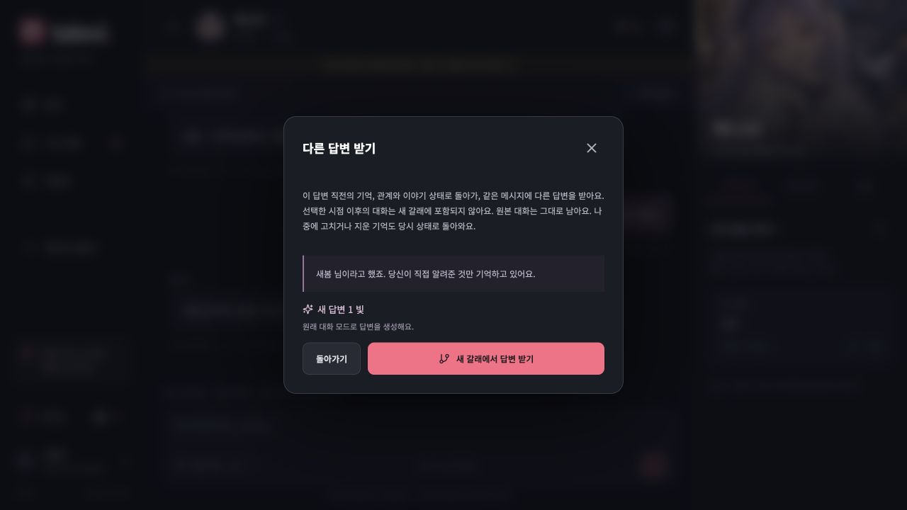
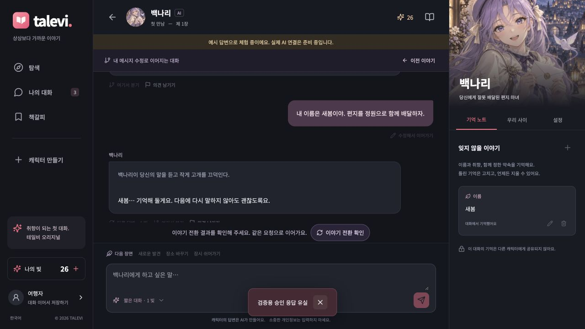

# 답변 재생성, 메시지 편집과 이야기 분기

2026-10-15 구현 기록. 웹과 React Native 앱이 같은 API와 상태 복원 규칙을 사용한다.

## 사용 방식

| 기능 | 시작하는 시점 | 새 답변 | 비용 |
| --- | --- | --- | --- |
| 답변 재생성 | 해당 답변을 요청하기 직전 | 당시 사용자 메시지와 대화 모드로 다시 생성 | 짧은 대화 1 빛, 이야기 3 빛 |
| 메시지 수정 | 선택한 사용자 메시지를 보내기 직전 | 수정한 내용으로 생성. 기존 모드와 이야기 이벤트 유지 | 짧은 대화 1 빛, 이야기 3 빛 |
| 여기서 분기 | 선택한 캐릭터 답변이 완료된 직후 | 사용자가 다음 메시지를 보낼 때 생성 | 분기 자체는 무료 |

세 기능 모두 새 대화를 만들고 그 대화로 이동한다. 원래 대화와 이후 메시지는 그대로 남으며, 새 갈래에는 선택 시점 이후의 대화를 넣지 않는다. 상단의 이전 이야기 버튼으로 원본에 돌아갈 수 있고, 나의 대화 목록에서도 갈래를 구분한다. 원래 대화에서 작성하던 초안도 유지한다.

기억 역시 당시 상태로 돌아간다. **원본에서 나중에 수정하거나 잊게 한 기억도, 그보다 앞선 시점으로 분기하면 당시의 값으로 복원된다.** 기억 노트의 수정과 삭제는 그 대화 갈래에 적용된다. 이 기능은 계정 데이터의 영구 삭제 기능과 다르다.

## 정확한 복원 범위

첫 장면과 새 턴의 전후에 체크포인트를 저장한다. 사용자 메시지를 접수할 때는 차감, 작업 생성, 직전 상태를 한 트랜잭션에 저장한다. 답변 완료 시에는 답변, 기억, 관계, 이야기와 완료 시점 체크포인트를 함께 저장한다. 중간 단계만 성공한 상태를 만들지 않는다.

- 기억 값, 수동 잠금, 삭제 표시와 근거 메시지
- 신뢰, 친밀 단계, 갈등, 관계 변화 근거와 중복 발언 판정 기록
- 장면, 목표, 선택, 미해결 사건, 이야기 전개와 에피소드 인용
- 기억 사용 여부, 관계 속도, 답변 분량과 문맥 초기화 시점
- 해당 시점의 메시지 목록, 모델에 전달하는 선택적 가림 처리와 메시지 상태

체크포인트에는 대화 원문이나 전체 메시지 식별자 목록을 반복 저장하지 않는다. 변경할 수 없는 메시지 삽입 순번의 경계와 개수, 필요한 가림 처리 정보와 상태를 저장한다. 새 갈래의 메시지는 별도 식별자로 복제하고 기억과 이야기의 근거 식별자 및 삽입 경계도 함께 치환한다. 복제된 과거 메시지에서 다시 편집하거나 분기할 수도 있다. 시간 값은 보존해 에피소드 압축과 문맥 초기화 기준이 달라지지 않게 한다. 나중에 과거 날짜로 추가된 메시지도 삽입 경계 밖이므로 과거 분기에 들어오지 않는다.

체크포인트 기능 도입 전의 과거 턴은 복원에 필요한 기록이 없다. 현재 상태로 과거 상태를 추측하지 않으며, 해당 메시지에는 기능을 제공하지 않는다. **기존 대화에서도 업데이트 이후 새로 나눈 턴부터 사용할 수 있다.**

## 중복 요청과 실패

`POST /v1/conversations/{cid}/branches`는 `client_id`, `message_id`, `action`, 편집할 경우 `content`를 받는다. 응답은 새 `conversation_id`, 생성 작업 `turn_id`, `status`, `cost`다. 단순 분기의 `turn_id`는 `null`이다.

웹과 앱은 요청을 전송하기 전에 기기에 저장한다. 응답을 받은 뒤에도 새 대화를 불러오기 전까지 결과를 보관한다. 전송 결과를 알 수 없으면 같은 요청 번호로 재확인한다. 새 생성 요청을 추가로 보내지 않으므로 네트워크 재시도가 중복 차감이나 중복 분기를 만들지 않는다. 이미 완료된 답변은 저장된 내용을 불러온다.

서버는 소유권과 활성 작업을 확인하고 사용자별 요청 번호를 직렬화한다. 잔액 부족이나 잘못된 시점은 분기 생성과 차감을 함께 취소한다. 답변 생성이 실패하면 기존 환급 경로로 한 번만 환급한다. 원본 대화는 변경하지 않는다.

## 비용을 발생시키지 않는 검증

테스트는 별도 PostgreSQL DB에서 실행한다. `conftest.py`는 `DEMO_MODE=true`, `RUN_WORKER=false`, 빈 `OPENAI_API_KEY`를 강제하며, 기본 HTTP 전송 계층을 차단한다. 실제 외부 요청을 시도하면 테스트가 실패한다. ASGI API 요청과 명시적으로 만든 모의 응답만 허용한다.

30명 전체에 대해 고정 응답을 이용해 미래 상태 생성 → 과거 분기 → 답변 재생성 → 사용자 메시지 편집을 검사한다. 실제 모델에 전달할 문맥이 직전 상태와 같은지, 나중에 생긴 정보가 섞이지 않는지, 근거 메시지가 새 갈래를 가리키는지와 원본 보존을 확인한다. 이는 상태 복원 검사이며 모델의 창의성이나 말투 품질을 새로 평가한 결과가 아니다.

```sh
npm run typecheck
npm run test:chat-stream
npm run test:mobile-chat
npm run build
cd apps/api
../../.venv/bin/python -m pytest -q
```

## 운영 시 고려할 점

마이그레이션 `7bc54c1d8a20`은 대화의 분기 정보, `conversation_checkpoints`, `branch_requests`를 추가한다. 후속 `93acde81f204`는 메시지에 `Identity bigint` 순번을 추가한다. 기존 대화 내용이나 결제 기록은 변경하지 않으며, 초기 v1 체크포인트도 계속 읽을 수 있다. 로컬 서비스 DB에 두 마이그레이션을 적용하고 API를 재시작했다. 배포 시 API와 워커 모두 새 스키마로 재시작해야 한다.

가림 처리한 메시지가 많아지면 문맥 마스크의 저장량은 늘어난다. 분기 자체는 해당 시점까지의 메시지와 상태를 복제하므로 공개 운영 전 분기 생성 지연과 저장 용량, 보관 정책을 검토해야 한다. 이번 검증은 로컬 동작과 복원 정확성에 집중하며 출시 규모의 부하 시험이나 네이티브 실기기 검증을 대신하지 않는다.

## 최종 검증 결과

이번 작업의 유료 AI 호출은 **0건**이다. 자동 테스트와 별도 데모 DB의 브라우저 확인에 실제 모델을 사용하지 않았다.

| 검사 | 결과 |
| --- | --- |
| PostgreSQL API 회귀 | 101개 통과 |
| 30명별 분기, 재생성, 편집 | 30명 모두 통과. 위 API 검사에 포함 |
| 상태 복원 집중 검사 | 9개 통과. 위 API 검사에 포함 |
| 웹 SSE 장애 및 재연결 | 7개 통과 |
| React Native 비동기 동작 | 모의 네이티브 환경 26개 통과 |
| 정적 검사와 빌드 | TypeScript, Ruff, Next.js 빌드, Expo iOS/Android export 통과 |
| 마이그레이션 | 격리 DB와 기존 로컬 DB에 적용, Alembic 모델 차이 없음 |
| 긴 대화의 메시지 경계 저장 | 메시지 2,000개 증가에도 경계 저장 증가량 32바이트 미만 |
| 모바일 웹 | 390×844 화면에서 복원 안내, 비용, 실행 버튼과 대화별 액션 배치 확인 |

브라우저에서는 `가온`이라는 이름을 저장한 뒤 원본에서 `다온`으로 바꾸고, 첫 답변을 재생성해 `가온` 시점으로 돌아가는 것을 확인했다. 첫 메시지를 `새봄`으로 편집하면 새 갈래에만 `새봄`이 저장됐고, 원본의 이후 메시지와 `다온` 기억, 작성 중인 초안은 유지됐다.

무료 분기 응답을 의도적으로 유실시킨 뒤 새로고침했다. 원 대화를 다시 열어 재확인했을 때 같은 `client_id`가 전송됐으며 대화 수는 4개, 잔액은 26 빛으로 그대로였다. 추가 분기나 차감이 없었다. 화면의 답변은 동작 검증용 예시이며 실제 AI 답변 품질을 보여 주는 자료가 아니다.




