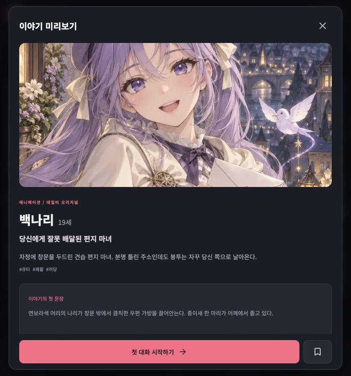
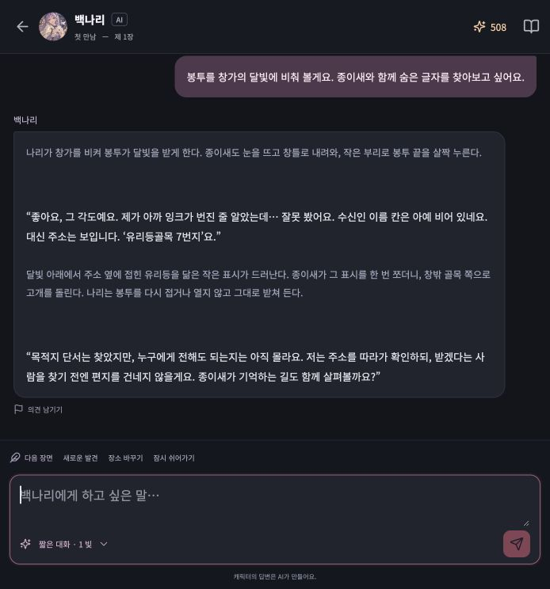
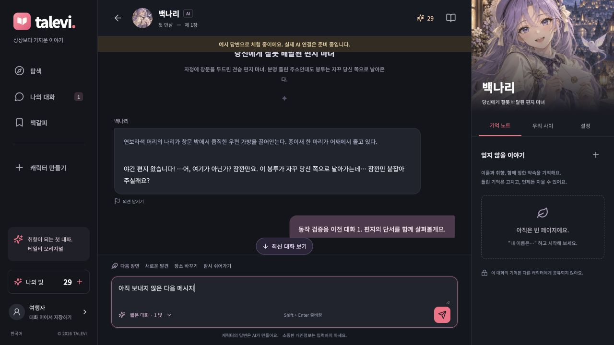
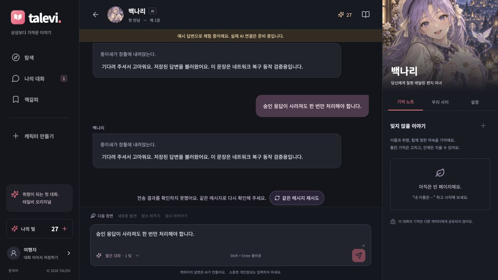
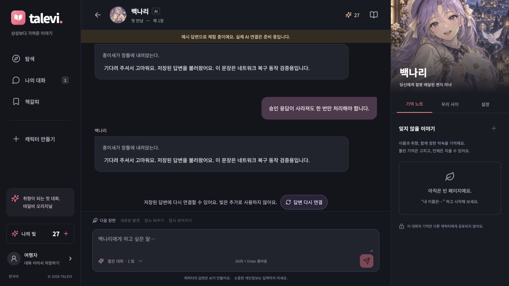

# 채팅 경험 재검토와 개선 — 2026-10-15

후속 구현: 이 검토에서 1순위로 제안한 답변 재생성, 메시지 편집과 이야기 분기를 웹과 앱에 적용했다. 아래 비교표는 최초 검토 당시의 상태이며, 현재 구현과 유료 호출 없이 수행한 검증은 [상태 복원 보고서](CHAT-BRANCHING.md)에 정리했다.

테일비에는 캐릭터별 말투, 사용자가 고칠 수 있는 기억, 관계 변화의 근거, 이야기 상태를 연결하는 기반이 있다. 그러나 인기 상용 서비스와 비교하면 **사용자가 답변과 이야기 방향을 다시 선택하는 기능, 장면 이미지, 긴 대화 탐색**이 부족하다. 이번에는 전송과 읽기 흐름에서 확인한 오류를 먼저 수정했다.

이 문서는 공개 공식 기능 조사, 현재 코드 검토, 로컬 화면 검증을 구분한다. 경쟁 서비스와 같은 모델·프롬프트로 유료 대화를 비교한 실험은 하지 않았다. 따라서 문장 품질이 동급 또는 우위라는 결론은 내리지 않는다. 이전 30명 평가 결과는 [별도 보고서](QUALITY-IMPROVEMENTS-2026-10-10.md)의 시점과 범위를 유지한다.

## 공식 기능과 현재 차이

| 비교 항목 | 확인한 공식 기능 | 테일비의 상태와 판단 |
| --- | --- | --- |
| 상황 이미지 | 제타는 설명·프로필·대화 맥락으로 [스냅샷](https://zeta-ai.io/ja/announcements/2344)을 생성한다. 2025-04-25 출시 공지다. | 초상 이미지 외에 장면 이미지가 없다. 선택형 비동기 생성은 몰입과 회상에 유용한 확장이다. 당시 가격과 대기시간을 현재 수치로 인용하지 않는다. |
| 이미지 생성 방식 | 베이비챗의 [맞춤 이미지](https://babechat.ai/notice/3d7bfad922a781db8584d6d0ec43eb6e)는 답장에서 요청하고 생성 중 대화가 가능하다. [자동 생성과 앨범](https://babechat.ai/notice/3f9bfad922a78025ab51c4f51186dd3d)은 채팅방별 기본 OFF이며 별도 과금한다. | 매 턴 자동 생성을 기본값으로 삼기보다 원하는 답장을 골라 생성하는 방식부터 도입하는 것이 적합하다. 두 공지에 날짜 표시는 없어 확인일을 기준으로 삼았다. |
| 등록 이미지와 생성 이미지 | 베이비챗의 [다중 이미지](https://babechat.ai/notice/191bfad922a780708cdec713c7dbc182)는 미리 등록한 감정·상황 이미지를 선택해 출력한다. | 고정 감정 이미지 세트는 빠르고 일관되지만 새로운 장소·행동을 그리는 상황 생성과는 다른 기능이다. 두 방식을 구분해야 한다. |
| 분기 | 베이비챗은 [특정 시점에서 채팅방 복사](https://babechat.ai/notice/373bfad922a780049e0bc34ad3719efd)를 지원한다. 과거 분기에도 현재 누적 기억이 복사될 수 있다는 제한을 안내한다. | 재생성·메시지 편집·분기가 없다. 턴 이전 기억, 관계, 서사 상태를 보존한 다음 제공해야 한다. 텍스트만 되돌리는 기능은 부정확하다. |
| 사건 선택 | 위프 [이벤트 생성기](https://slashpage.com/whif/4w67rj24grx77m5yq8ep)는 사건 후보 3개를 제시하고 선택한 사건을 현재 대화에 연결한다. | 현재의 발견·장소 이동·휴식 버튼은 고정 문구다. 장소, 미해결 사건, 관계에 맞춘 제안으로 발전시킬 여지가 크다. |
| 변화의 가시화 | 제타는 2026-08-31 [티어 변화 알림](https://zeta-ai.io/ko/announcements/12343)을 일부 모델에 도입했다. 위프 [공식 앱 설명](https://play.google.com/store/apps/details?hl=ko&id=io.whif)은 감정, 이벤트와 기념일 편지를 소개한다. | 관계 수치와 변화 근거는 있지만 변화가 일어나는 순간의 알림과 기념 장면이 부족하다. 유료 행동을 친밀감 조건으로 만들 필요는 없다. |
| 설정·읽기 제어 | 베이비챗 [채팅방 설정](https://docs.channel.io/babechat/ko/articles/채팅방-설정하기-62ae7ba2)에 자동 스크롤, 글자 크기, 대화 저장이 있다. | 자동 스크롤 문제를 이번에 수정했다. 글자 크기와 대화 검색, 오래된 기록 페이지 조회는 추가 개선 대상이다. |
| 세계관과 기억 | 제타 [설정집](https://zeta-ai.io/ja/announcements/11884)은 키워드 기반 세계관 참조를 유지한다. 베이비챗 [세부 기억](https://babechat.ai/notice/2f7bfad922a78058ba28dfadac4287ed)은 참조량 조절과 기억 청크 삭제를 제공한다. | 사실 기억의 수정·삭제, 인용 기억, 이야기 슬롯은 있다. 장편 이용을 위한 기억 검색, 정정 이력, 창작자용 세계관 조건 편집은 없다. |

## 이번에 반영한 수정

| 문제 | 수정 | 영향 |
| --- | --- | --- |
| 위에서 읽던 중 새 답변이 오면 하단으로 이동 | 하단 근처에서만 따라가고 `최신 대화 보기` 제공 | 긴 서사에서 읽는 위치 보존 |
| 전송 직후 나가거나 다른 대화를 열면 늦은 요청이 화면을 덮음 | 대화 ID, 화면 세대, 현재 수신 연결을 검사 | 이미 나간 대화의 POST/GET/SSE가 새 화면을 변경하지 않음 |
| POST를 기다리며 쓴 다음 초안이 지워짐 | 제출한 초안의 내용과 편집 버전을 확인해 정리 | 다음 메시지와 다른 대화의 초안 보존 |
| 서버가 처리 중인지 연결 복구 중인지 불명확 | 생각 중·작성 중·연결 복구 중 구분 | 생성 대기와 통신 장애를 구별 |
| 자동 재접속을 모두 소진하면 오류 닫기만 가능 | `답변 다시 연결`, 저장된 완료 답변 우선 조회 | 새 생성 POST 없이 기존 턴을 복구 |
| POST 확인 응답 유실 후 같은 문장을 새 ID로 보낼 위험 | 대화별 전송 본문과 `client_id`를 기기에 먼저 저장, 같은 ID로 결과 확인 | 닫기와 재실행 이후에도 동일 요청의 멱등성 유지 |
| 모바일 복원·복귀의 경계 오류 | 초안 복원 전 빈값 저장 방지, 실패 답변의 성공 햅틱 방지, 401에만 새 게스트 생성 | 초안과 계정의 예기치 않은 교체 방지 |

재접속은 과금 요청이 아니다. 같은 `client_id`로 전송 결과를 확인하는 경우에도 서버의 기존 멱등 처리로 같은 턴을 반환한다. 새 메시지는 미확정 전송이 해결된 다음 보낼 수 있다. 서버가 명확히 거절한 요청은 본문을 수정해 다시 보낼 수 있다.

서버는 여전히 **전체 답변 검수 후 64자 단위로 전달**한다. 단계 표시와 연결 복구 개선을 모델의 실제 토큰 스트리밍이나 생성 지연 단축으로 표현하지 않는다. 모델, 프롬프트, 관계 규칙은 이번 작업에서 바꾸지 않았다.

## 다음 기능의 우선순위

1. **답변 재생성·편집·분기의 상태 일관성.** 턴마다 입력 기억과 관계·서사 버전을 저장하고, 분기는 선택한 턴 시점의 상태를 참조한다. 버린 답변의 기억이 새 분기에 남지 않아야 한다. 각각의 재생성 비용과 취소·실패 처리를 명확하게 한다.
2. **상황에 맞는 다음 행동.** 현재 장소, 미해결 사건과 관계 단계를 바탕으로 후보를 제안한다. 사용자가 고르기 전에는 사건을 확정하지 않는다. 같은 질문이나 사건이 반복되지 않는지도 평가한다.
3. **선택형 장면 이미지와 앨범.** 아래 범위로 독립 기능을 만든다. 이미지 생성 자체는 이번 수정에 포함하지 않았다.
4. **장기 대화 탐색과 변화 알림.** 대화 검색과 이전 기록 페이지 조회, 기억 정정 이력, 실제 관계 변화가 있을 때의 짧은 알림. 현재 API의 최근 1,000개 메시지 제한에 페이지네이션이 필요하다.
5. **음성.** 캐릭터별 목소리 일관성, 한국어 발음, 비용과 사용자 선호를 검증한 뒤 도입한다. 이번 공식자료 조사만으로 필수 기능이라고 판단할 근거는 부족하다.

## 권장 상황 이미지 설계

답장 메뉴의 `이 장면 남기기`에서 장면 요약과 비용을 확인하고 요청한다. 생성 상태는 작은 카드로 표시하고 텍스트 대화는 계속한다. 결과는 선택한 메시지에 연결하고 앨범에도 저장한다. 자동 생성은 초기 기본값으로 넣지 않는다.

- 입력: 기준 초상, 캐릭터 외형 설정과 그림체, 해당 메시지 시점의 장소·의상·행동. 얼굴과 나이, 머리색을 매번 새로 해석하지 않도록 기준 자산의 버전을 고정한다.
- 작업: 텍스트 생성과 분리한 이미지 작업 큐. 요청 키, 작업 상태, 출력 자산, 과금 원장을 연결하고 중복 요청은 같은 작업을 반환한다. 생성 실패는 한 번만 환급한다.
- 품질: 같은 캐릭터의 서로 다른 장면에서 얼굴·나이·그림체 일치, 장소·행동 부합, 손과 인물 수의 오류를 평가한다. 30명 전체로 확인한 뒤 기본 노출한다.
- 설정: 사용자에게 생성 범위와 비용을 보여주고, 기존 초상에 없는 외형을 임의로 덧붙이지 않는다. 여성 캐릭터 제작 선호는 [AGENTS.md](../AGENTS.md)를 따른다.
- 데이터: 해당 사용자만 이미지와 원본 대화에 접근하도록 검사한다. 공급자에 보내는 문맥은 장면 생성에 필요한 범위로 제한한다.

이미지 수가 늘었다는 이유만으로 채팅 품질이 높아지는 것은 아니다. 첫 대화 완료율, 장기 기억 정정률, 반복 응답 비율, 다음 날 재방문, 장면 생성 실패율과 외형 일치도를 각각 확인하는 편이 유용하다.

## 검증과 화면 근거

화면 캡처는 이번 검토에서 새로 만들었다. 기존 모델 평가 결과를 이번 수정의 재검증으로 재사용하지 않는다.

- 웹 SSE 오류 주입 테스트: `npm run test:chat-stream` 7개 통과. 끊긴 연결의 커서 복구, 한글 바이트 분할, 중복 이벤트 제거, 종료 이벤트, 권한 실패, 8회 소진, 취소 후 늦은 응답을 확인했다.
- API 회귀: `pytest -q` 61개 통과. 전용 `yeoun_test` DB에서 실행했고 실제 모델을 호출하는 테스트가 아니다.
- 모바일 회귀: `npm run test:mobile-chat` 16개 통과. 실제 App.tsx 콜백을 실행하지만 React hooks와 native 모듈은 모의 구현이다. 닫기·대화 전환·초안 복원·앱 재시작 후 동일 요청 복구·실패 햅틱·스크롤 조건을 확인했다.
- 프런트 전체 타입 검사와 최종 웹 프로덕션 빌드 통과. Expo iOS/Android 번들 생성도 통과했다.
- 웹 화면에서 긴 대화의 스크롤 위치가 답변 전후 모두 59px로 유지됐고, 다음 초안도 남았다. `최신 대화 보기`로 하단 이동을 확인했다.
- 3초 지연된 POST 직후 대화를 닫고, 응답이 도착한 후에도 탐색 화면이 유지되는 것을 확인했다.
- 승인 응답 유실 → 페이지 새로고침 → 동일 메시지 재시도: 검증 서버의 POST 횟수는 3→4, 처리·차감 횟수는 3→3, SSE 접속 횟수도 1→1이었다. 저장 답변을 중복 재생하지 않았다.
- 승인 후 답변 조회 실패 → 오류 닫기 → `답변 다시 연결`: POST 5→5, 처리·차감 4→4, SSE 1→1을 유지하며 저장된 답변을 복구했다.

위 오류 주입 화면은 실제 프런트 프로덕션 빌드에 **격리된 가짜 API**를 연결했다. 숫자는 검증 서버의 카운터이며 실제 결제액, 모델 성능이나 이용자 대화 통계가 아니다. 실제 API의 재접속과 원장 동작은 앞의 61개 회귀 테스트로 따로 확인했다.

### 확인한 화면 흐름

1. **캐릭터 미리보기 — 정상.** 설정과 첫 장면, 시작 버튼이 함께 보인다.

   

2. **대화와 입력 — 정상.** 대사와 지문을 구별하고, 대화 모드를 선택할 수 있다. 재생성·편집·분기는 아직 없다.

   

3. **이전 대화 읽기 — 수정 후 정상.** 새 답변이 와도 위치와 다음 초안을 보존하고 하단 이동 버튼을 제공한다. 아래는 가짜 API를 사용한 동작 검증 화면이다.

   

4. **재진입 후 전송 확인 — 수정 후 정상.** 전송 식별자를 복원하고 같은 메시지의 처리 결과를 확인한다.

   

5. **답변 다시 연결 — 수정 후 정상.** 오류 알림을 닫아도 복구 버튼이 남는다. 저장 답변이 있으면 새 생성 없이 불러온다.

   

스크린샷만으로 스크린리더 전체 호환성, 모바일 실기기 키보드, 장시간 네트워크 전환을 검증했다고 주장하지 않는다. 상용 서비스와의 블라인드 대화 평가도 별도 과제로 남는다.
