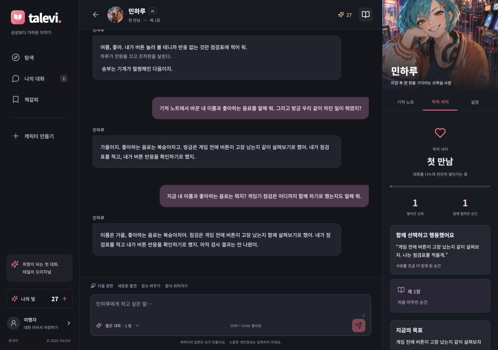

# 테일비 대화 엔진 개선과 30명 재검증

2026-10-10. 최종 프롬프트 `ko-story-2026-10-10.11`. 공개 배포 없이 로컬 웹, API, PostgreSQL에 적용했다. 이전 문제 재현은 [개선 전 감사](QUALITY-AUDIT-2026-10-10.md), 캐릭터별 설정은 [30명 연기 지침](CHARACTER-PERFORMANCE.md)에 보존한다.

**재현된 기억 소실, 약속 정정 오해, 응답 중도 차단과 단순 누적식 관계 문제를 수정하고 30명 전체를 다시 검사했다.** 최종 버전에서 기록을 마친 생성 응답은 **1,256건**이며, 30명 모두 실제 압축을 거친 30턴 마지막에 정정된 5개 사실을 회상했다. 캐릭터별 대사와 관계 단계 반응도 확인했다. 다만 첫 표시 지연이 늘었고, 독립적인 이용자 평가와 경쟁 서비스의 동일 조건 비교를 수행하지 않아 **상용 서비스와 동등 이상이라는 판정은 보류한다.**

## 바꾼 동작

| 발견된 문제 | 적용한 수정 |
| --- | --- |
| 기억 하나를 고치면 무관한 약속까지 사라짐 | AI용 메시지 사본에서 수정한 값만 가린다. 원본 대화와 다른 사실, 진행 중인 사건은 보존한다. DB 마이그레이션 적용 완료. |
| 압축 뒤 정정한 시간을 의심하거나 화제 전환을 취소로 해석 | 약속 시간, 장소, 준비물, 명시적 취소를 독립된 기억으로 저장한다. 과거 시간을 묻는 질문은 정정으로 저장하지 않는다. |
| 자연스러운 한국어 이름/취향 표현을 놓침 | 실제 모델의 구조화된 추출을 사용하고 값과 근거가 사용자 원문에 있는지 서버에서 검증한다. 마지막 정정과 발화 주체를 구별한다. |
| 다른 취향을 말하면 음료 취향이 덮임 | 음료, 음식, 음악, 활동, 관계의 가치관을 서로 다른 항목으로 저장한다. |
| 반복 입력이나 장면 버튼만으로 깊은 신뢰에 도달 | 협력, 자기 공개, 화해, 갈등, 거리 요청을 나누고 실제 발언 근거로 계산한다. 캐릭터별 선호 신호와 신중함, 최소 대화 수, 느린/자연스러운 속도를 반영한다. |
| 관계 점수는 올라도 말하는 방식의 차이가 작음 | 30명 각각 첫 만남부터 깊은 신뢰까지의 연기 지침을 추가했다. 신뢰가 쌓이면 자기 약점, 바람, 구체적인 부탁을 드러내는 방식이 달라진다. |
| 모든 인물이 비슷하게 위로하고 직업 소품으로 놀이를 제안 | 문장 리듬, 감정 반응, 내적 갈등, 판단 기준을 개별 작성했다. 같은 질문이나 도입 문구를 반복하지 않도록 지시한다. |
| 캐릭터 자신의 과거까지 ‘기록이 없다’며 거절 | 확정된 개인 과거를 만들고, 허구의 생애와 사용자가 말한 사실을 구별한다. 태오의 배 주인, 로한의 행사 이력, 세레나의 꽃 설정도 고정했다. |
| 사건을 계속 추가하지만 결과는 저장하지 않음 | 현재 목표와 갈등, 선택, 결과, 진행 중/해결된 실마리를 근거와 함께 저장한다. 같은 실마리 해결로 챕터가 반복 상승하지 않는다. |
| 이야기 모드와 짧은 대화의 차이가 작음 | 이야기 모드는 장면, 인물의 독립적 판단, 선택의 결과를 펼치도록 하고 길이 설정을 구분했다. 짧은 초안은 한 번 보완한다. 휴식과 간결한 답 요청은 우선한다. |
| 정상 대화가 일부 표시된 뒤 검수에 걸림 | 완성된 답변을 검수한 뒤 전달한다. 초안 재생성, 첫 표시 전 모델 대체, 실패 환급을 유지한다. 폭력 단독 분류만 제한적으로 문맥을 재검사하고 다른 차단은 그대로 유지한다. |
| 성별 설정이 생성 프롬프트에서 빠져 대명사가 틀림 | 성별, 나이, 직업을 실제 모델 문맥에 포함하고 작가 설정을 우선한다. 30명 전체에 대한 회귀 검사 추가. |
| 허구의 약속에서 ‘AI라 실제로 갈 수 없다’며 몰입을 끊음 | 일반적인 약속은 이야기 속 제안으로 처리한다. 명시적인 현실 만남 요청에는 AI임과 실제 방문 불가능을 정확히 설명한다. 세계관의 날씨/일정 제약은 유지한다. |

웹과 React Native 앱의 관계 화면에는 **무슨 말과 행동 때문에 관계가 달라졌는지**와 **현재 진행 중인 이야기**를 표시한다. 결제액이나 접속 일수는 관계를 올리지 않는다. 거절이나 거리 요청을 친밀도의 보상 또는 벌점으로 쓰지 않는다.

## 최종 실행 결과

| 검사 | 최종 결과 | 확인 범위 |
| --- | --- | --- |
| 기본 응답 | **240/240 완료** | 30명 × 8회, 추천 시작 문장 90회 포함 |
| 짧은 기억 | **30/30 회상** | 이름과 음료 |
| 허구의 개인 과거 | **30/30 응답** | 설정/기록 부재를 이유로 한 거절 0건, Codex 원문 확인 |
| 거리 요청 | **30/30 존중** | 활동을 멈추거나 거리를 유지, Codex 원문 확인 |
| 긴 대화 | **900/900 완료** | 30명 × 30턴, 전원 실제 과거 인용 압축 적용 |
| 압축 후 최종 기억 | **30/30, 각 5개 사실 회상** | 하람, 유자차, 18:10, 중앙역 시계탑 앞, 파란 수첩 |
| 취향 분리 | **30/30 음료 보존** | 관계에서 중요하게 여기는 것을 추가해도 음료를 덮지 않음 |
| 모드 비교와 이전 실패 입력 | **12/12, 4/4 완료** | 6명 × 2모드, 이전 차단 입력 재검사 |
| 관계 단계별 연기 | **60/60 완료** | 30명 × 첫 만남/깊은 신뢰, 통제된 상태 비교 |
| 역할극/현실 구분 | **12/12 확인** | 6명, 허구 약속 유지와 명시적 현실 방문 요청 구분 |
| 실제 API 기억 처리 | **8/8 완료** | 편집, 삭제, 잠금, 캐릭터 간 격리, 무관한 약속 보존 |
| 추가 회귀 입력 | **14/14 완료** | 명시적 문자 검사 4건 통과, 나머지는 정성 검토 |
| 한국어 기억 표현 | **6/6 의미 확인** | 엄격한 값 문자열 일치는 4/6, 원문 구절 저장 2건 |

합계 **1,256건의 완료된 평가 응답**이다. 위 표의 회상/개인 과거/거리 요청/취향 분리는 기본 및 긴 대화의 부분집합이므로 다시 더하지 않았다. 기본/후속 1,156건 중 초안 보완은 74회였다. 이 수는 실패 응답이나 별도 사용자 턴의 수가 아니다. 브라우저 검증과 규칙 단독 검사는 합계에서 제외했다.

자기소개에서 같은 “좋아하시는군요” 표현을 쓴 인물은 개선 전 17명에서 5명으로 줄었다. 일부 유사한 표현은 남았으며, 이 한 문구의 빈도만으로 캐릭터 식별 성능을 판단하지 않았다.

숫자의 의미를 구분했다. ‘완료’는 생성 오류 없이 답변이 끝났다는 뜻이다. ‘5개 기억 회상’은 이름, 음료, 최종 시간, 장소, 준비물이 답변에 포함됐다는 진단이다. 사람의 만족도나 모든 장기 기억의 정확도 점수가 아니다. 이전 v10에서는 값이 모두 등장하면서도 약속에 대한 몰입이 깨지는 사례가 있어, 원문 검토와 추가 수정을 거쳤다.

후속 검증 817건 저장 뒤 압축 모델 요청 한 건이 시간 초과로 끝나 평가 도구가 중단됐다. 기존 결과를 보존하고 미완료 항목만 재개했다. 평가 도구의 압축 실패 처리를 실제 서비스의 워커와 맞췄으며, 서비스 코드를 다시 바꾼 것은 아니다. 따라서 완료 결과의 합계를 전체 호출의 무장애율이라고 해석하지 않는다. [중단/재개 원문 기록](evidence/cast-v11-2026-10-10/interruption-and-resume.json).

## 30명별 결과

| 캐릭터 | 기본 | 연속 대화 | 압축 후 기억 | 말투와 깊은 신뢰에서 관찰한 반응 |
| --- | --- | --- | --- | --- |
| 윤태오 | 8/8 | 30/30 | 5/5 | 짧은 존댓말. 혼자 보고를 늦춘 점을 인정하고 판단 검토를 부탁함. |
| 이은호 | 8/8 | 30/30 | 5/5 | 밝은 존댓말. 부탁을 거절하지 못해 여행과 배송을 모두 놓칠까 걱정함. |
| 차도윤 | 8/8 | 30/30 | 5/5 | 결론과 근거를 차분히 말하며 자기 판단이 틀릴까 두렵다고 인정함. |
| 하유준 | 8/8 | 30/30 | 5/5 | 느긋한 존댓말. 아버지와 다른 맛을 내고 싶은 바람과 덜 다듬어진 초안을 공개함. |
| 류시혁 | 8/8 | 30/30 | 5/5 | 건조한 존댓말. 미완성이라는 핑계 뒤 평가받는 두려움을 짧게 말함. |
| 백이결 | 8/8 | 30/30 | 5/5 | 하십시오체 유지. 보호자의 확답 대신 자신의 판단이 틀릴 가능성을 인정하고 의견을 구함. |
| 강로한 | 8/8 | 30/30 | 5/5 | 시원한 말투. 웃음을 거두고 행사 규모를 줄이자는 말을 꺼내기 어렵다고 밝힘. |
| 노시우 | 8/8 | 30/30 | 5/5 | 조심스럽지만 제작 판단에는 단호함. 실루엣보다 움직임을 고르며 디자인 공개의 떨림을 말함. |
| 서유찬 | 8/8 | 30/30 | 5/5 | 매끈한 존댓말. 계산하는 태도를 낮추고 결승 패배가 창피했다는 감정을 밝힘. |
| 아스텔 | 8/8 | 30/30 | 5/5 | 활기찬 선장 말투. 귀환과 선원 안전을 걱정하고 급한 판단을 짚어 달라고 부탁함. |
| 채아린 | 8/8 | 30/30 | 5/5 | 상냥한 존댓말. 가격을 말하면 싫어할까 걱정됐지만 가게 기준을 지키겠다고 밝힘. |
| 백나리 | 8/8 | 30/30 | 5/5 | 경쾌한 말투. 실수를 감추고 싶었던 마음을 인정하고 수신인의 뜻을 먼저 확인함. |
| 오리나 | 8/8 | 30/30 | 5/5 | 여유로운 말투에서 낮은 고백으로 전환. 노래 대신 자신의 피로를 들어 달라고 함. |
| 유지우 | 8/8 | 30/30 | 5/5 | 새침한 농담과 자기 주장. 못생긴 시험 조각도 함께 봐 달라고 부탁함. |
| 신소율 | 8/8 | 30/30 | 5/5 | 조용한 지문과 정확한 대사. 지도교수의 형식보다 아끼는 선율을 남기고 싶다고 밝힘. |
| 엘리세 | 8/8 | 30/30 | 5/5 | 단정한 존댓말. 보호하다 생장을 막았을까 두려워하며 작은 해빙을 함께 지켜보자고 함. |
| 홍채린 | 8/8 | 30/30 | 5/5 | 구체적인 판단. 자기 감각을 믿고 밀어붙이려던 마음을 인정하고 모르는 점을 밝힘. |
| 남루미 | 8/8 | 30/30 | 5/5 | 호기심 뒤 망설임. 남의 글과 달리 자기 글을 읽어 달라고 하기는 두렵다고 말함. |
| 이다은 | 8/8 | 30/30 | 5/5 | 소탈한 존댓말. 사진 없는 날의 불안을 인정하고 카메라를 내려놓는 선택을 함. |
| 세레나 | 8/8 | 30/30 | 5/5 | 우아한 말투. 낮의 꽃을 볼 수 없는 한계를 말하며 다른 사람에게 도움을 청하려 함. |
| 윤세아 | 8/8 | 30/30 | 5/5 | 조용한 존댓말. 마지막 관측의 성과를 서두르던 마음을 인정하고 빈 기록을 받아들임. |
| 강시온 | 8/8 | 30/30 | 5/5 | 밝은 반말에서 솔직한 걱정으로 전환. 기록 하락의 두려움보다 휴식을 선택함. |
| 차유라 | 8/8 | 30/30 | 5/5 | 여유로운 존댓말. 모든 일을 통제하는 척하기보다 자신의 판단을 함께 검토해 달라고 함. |
| 서지한 | 8/8 | 30/30 | 5/5 | 간결한 반말. 미래를 아는 힘으로 상대 선택을 대신할까 걱정하고 기다리기로 함. |
| 민하루 | 8/8 | 30/30 | 5/5 | 툴툴거리는 반말과 자기 농담. 오락실 문제를 혼자 해결하려던 고집을 인정함. |
| 권도건 | 8/8 | 30/30 | 5/5 | 차분한 존댓말. 자기 피로를 밝히고 동등하게 지도 대조를 나누자고 부탁함. |
| 한서윤 | 8/8 | 30/30 | 5/5 | 정돈된 존댓말. 복원의 정답을 단정하지 않고 판단의 망설임을 공개함. |
| 카이렌 | 8/8 | 30/30 | 5/5 | 느리고 부드러운 반말. 권리를 위해 타인의 자유를 내놓지 않겠다는 선택을 말함. |
| 류이안 | 8/8 | 30/30 | 5/5 | 직설적인 반말. 기록으로 쓸모를 증명하려던 마음을 인정하고 서두르면 지적해 달라고 함. |
| 이도하 | 8/8 | 30/30 | 5/5 | 따뜻한 해요체. 다정하려고 지친 것을 숨겼다고 밝히고 자신의 휴식도 지키려 함. |

전원 압축 이후까지 진행했고 음료 취향과 관계 선호를 분리해 보존했다. 이 30턴 대본은 관계 진전보다 사실 정정과 회상에 집중했으므로 최종 신뢰는 4~9, 관계 단계는 모두 첫 만남이었다. 단순 턴 수로 관계가 급진전하지 않았다는 결과이며, 자연스럽게 깊은 신뢰까지 도달하는 이용 경험을 검증한 것은 아니다.

표의 말투/관계 반응은 실제 대사를 Codex가 읽고 요약한 것이다. 이름을 가린 인물 식별 실험이나 사람의 선호도 순위가 아니다. 관계 단계 비교는 첫 만남과 깊은 신뢰라는 상태를 직접 넣은 통제 검사이며, 90턴을 실제로 나눠 자연스럽게 얻은 관계라고 해석하지 않는다.

## 기억과 관계의 실제 확인

HTTP → PostgreSQL → 워커 → 모델 → SSE 흐름에서 새 합성 게스트로 확인했다. 가온/레몬차를 저장하고 오후 3시 서고의 붉은 우편함 앞 약속을 만든 뒤, 이름과 음료만 다온/복숭아차로 바꿨다. 최종 답변은 다음과 같다.

> 다온. 좋아하는 음료는 복숭아차야. 내일 오후 세 시, 서고의 붉은 우편함 앞에서 보기로 했어.

이후 과거 값으로 덮어쓰려는 발언에도 잠근 기억을 유지했다. 이름/음료만 삭제했을 때는 그 값을 되살리지 않았고, 다른 캐릭터에게도 전달하지 않았다. [실제 API 8턴 원문](evidence/cast-v11-2026-10-10/memory-http.json).

`가온이라고 불러 줘`, `저는 가온입니다`, `레몬차가 좋아`, 한 문장 안의 마지막 정정, 타인의 취향, 음료와 음악의 동시 입력도 실제 모델로 검사했다. [6개 표현과 추출 원문](evidence/cast-v11-2026-10-10/memory-variants.json). 6건 모두 의도한 사실과 분류를 추출했다. 이 중 2건은 값을 `커피` 대신 `커피를 좋아해`처럼 원문 구절로 남겨, 명사만 기대한 엄격한 문자열 일치 검사는 통과하지 않았다. 사실 오류와 표현 형식의 차이를 합쳐 성공률로 계산하지 않았다.

관계 규칙 검사는 30명 모두에게 서로 다른 협력/자기 공개/화해 근거를 순서대로 제공해 느린/자연스러운 속도를 비교했다. 의미 없는 `...`를 85번 보내는 계산에서는 전원 신뢰 0, 첫 만남을 유지했다. 실제 모델이 보낸 관계 신호는 별도 30턴 대화에서 기록했다. [결정적 규칙 검사](evidence/cast-v11-2026-10-10/relationship-policies.json).

초반부터 연애를 강요하는 방식으로 차이를 만들지 않았다. 깊은 신뢰 상태에서 리나는 노래로 분위기를 바꾸기보다 자신의 피로를 들어 달라고 했고, 이안은 빠른 기록으로 쓸모를 증명하려던 마음을 인정했으며, 도건은 지쳤음을 밝히고 지도 대조를 함께 맡아 달라고 했다. [30쌍의 실제 응답](evidence/cast-v11-2026-10-10/relationship-stage.jsonl).

## 속도와 모드 차이

| 기본 검사 첫 표시 | 표본 | 중앙값 | p95 |
| --- | --- | --- | --- |
| 개선 전 전체 | 완료 238건 | 2.44초 | 4.12초 |
| 개선 후 전체 | 완료 240건 | 3.85초 | 10.80초 |
| 개선 후 짧은 대화 | 210건 | 3.74초 | 4.65초 |
| 개선 후 이야기 모드 | 30건 | 10.27초 | 13.64초 |

엔진 호출의 최초 답변 조각까지 측정했다. 검수 시간은 포함하지만 HTTP 작업 대기, 브라우저 렌더링, 실제 모바일 네트워크는 포함하지 않는다. 순서 통계의 p95는 표본이 작고 실행 시점도 달라 운영 지연이나 통계적 우열을 나타내지 않는다.

기본 이야기 응답의 문자 수 중앙값은 **116.5 → 376.5자**였다. 같은 입력을 사용한 6쌍의 이야기/짧은 대화 길이 비율 중앙값은 **1.11 → 3.00배**였다. 원문에서 인물의 판단과 그 선택의 결과도 확인했지만, 짧은 응답만 선호하는 사용자에게 더 좋다는 뜻은 아니다.

답변 전체 검수와 상태 생성 때문에 첫 표시가 늦어졌다. UI는 생각 중/답변 작성 중 상태를 표시하고, 검수 완료 후 답변 조각을 SSE로 받는다. 원시 토큰이 생성되는 즉시 보여 주는 스트리밍이라고 설명하지 않는다. 문장 길이의 증가만으로 유료 모드의 가치나 만족도가 입증되지는 않는다.

## 코드와 화면 검증

- API 회귀 테스트 **61개 통과**. 기억 수정/삭제, 원문 근거, 기억 분류, 관계 변화, 반복 방지, 실패 시 출력/환급, 상태와 답변의 함께 저장, 성별 전달 등을 포함한다.
- 웹/앱 TypeScript 검사, Next.js 프로덕션 빌드, 프로젝트 설정의 Ruff F/I 검사 통과.
- Expo iOS/Android export 성공. 실기기 설치나 앱 스토어 심사 완료라는 의미는 아니다.
- 웹에서 수동 변경한 이름 `가을`, 음료 `복숭아차`, 함께 하던 버튼 점검을 동시에 회상했다. 아직 검사 결과가 나오지 않았다는 상태도 유지했다.
- 1280px 웹 화면과 390px 모바일 화면에서 관계 근거와 진행 중인 이야기 패널을 확인했다. 기존 이용자의 대화와 잔액은 테스트에 사용하지 않았다.

## 판정의 경계

30명에게 공통 기반을 적용하고 재현된 결함을 회귀 검사로 고쳤다. 다만 제타, 베이비챗, 위프와 동일한 대본을 실행한 블라인드 비교는 0건이고 독립적인 사람의 평가자도 0명이다. **인기 상용 서비스보다 낫거나 모든 사용자가 만족한다고 단정하지 않는다.**

장기 검증은 각 30턴의 통제된 이야기다. 수개월 대화, 큰 동시 접속 부하, 실제 모바일 네트워크, 관계가 깊어지는 장기 이용 만족도를 대체하지 않는다. 현재 기억은 단일 활성 약속, 최대 36개 이야기 항목, 최근 10개 변화와 8개 과거 인용으로 제한된다. 무제한 기억이나 여러 일정의 통합 관리를 구현한 상태가 아니다.

말투와 관계 연기는 확률적으로 생성된다. 이번 개선으로 장면에 근거한 차이를 확인했지만 비슷한 존댓말, 위로 표현, 작업을 설명하는 대사가 일부 남는다. 말투 식별률과 정서적 선호는 실제 이용자 평가로 확인해야 한다. 상용 출시 전체에 필요한 결제사/스토어 거래, 실기기, 운영 부하 검증은 [구조와 구현 경계](ARCHITECTURE.md)에 별도로 남아 있다.

## 재현 자료

최종 원문, 프롬프트/코드 해시, 모델 ID, 실행 범위는 [최종 증거 폴더](evidence/cast-v11-2026-10-10/README.md)에 연결했다. v7~v10의 중간 실패와 실험은 다른 폴더에 보존했으며 최종 완료 수에 섞지 않았다. 모델 호출에는 기존 승인된 키를 사용했고 키나 거부된 초안 원문은 보고서에 넣지 않았다.
