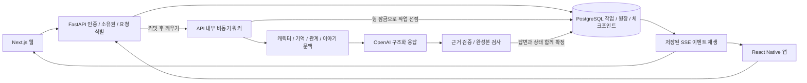

# 테일비의 대화 상태와 복구 설계

2026-10-15, 구현 기준 `2f512767a1461d58d8cf84675df8a254a7aecc33`.

테일비는 답변 한 번을 텍스트 생성으로만 처리하지 않습니다. 사용자가 한 말을 기억하고, 선택에 따라 관계와 이야기를 갱신하며, 연결이 끊기거나 과거 장면으로 돌아가도 그 상태와 비용이 맞도록 설계했습니다. 현재 로컬에서 동작하며 공개 운영 배포는 보류했습니다.

## 구조

웹과 앱은 공통 TypeScript 계약을 사용하고, 서버는 비동기 SQLAlchemy와 PostgreSQL로 상태를 관리합니다. 별도 Redis 큐 대신 DB 작업 큐를 선택했습니다. 작업 접수, 사용량 차감, 복원 상태를 같은 트랜잭션으로 다룰 수 있기 때문입니다. 대규모 동시 접속에 대한 처리량을 입증한 구성은 아닙니다.

## 1. 기억을 고쳐도 무관한 약속은 보존하기

이름을 `가온`에서 `다온`으로 수정했다고 과거 대화 전체를 버리면, 같은 문장에 있던 “내일 세 시에 서고에서 만나자”도 사라집니다. 테일비는 화면에 남기는 원본 메시지와 모델이 읽는 문맥을 분리합니다. 수정한 사실만 모델 문맥과 과거 인용에서 가리고, 무관한 약속과 사건은 유지합니다.

모델이 제안한 사용자 사실에는 원문 근거가 있어야 합니다. 이름, 음료, 음악, 관계 취향 등을 구분해 서로 덮어쓰지 않게 하며, 수동으로 잠그거나 삭제한 기억을 모델이 다시 저장하지 못하도록 합니다. 기억과 관계 상태는 답변이 성공한 턴에서 함께 확정합니다.

근거: [문맥 무효화 구현](../../apps/api/yeoun/memory_context.py), [기억과 관계 회귀 검사](../../apps/api/tests/test_quality.py). 2026-10-10의 실제 모델 평가와 이번 자동 검사는 [검증 결과](LATEST-VALIDATION.md)에서 구분했습니다.

## 2. 과거 답변에서 갈라져도 당시 상태로 돌아가기

답변만 잘라 붙이면 이후에 생긴 기억이나 관계가 과거 장면에 섞일 수 있습니다. 첫 장면, 사용자 메시지 접수 직전, 답변 완료 직후에 체크포인트를 저장합니다.

| 기능 | 복원하는 시점 | 처리 |
| --- | --- | --- |
| 답변 재생성 | 선택한 답변을 요청하기 직전 | 당시 입력과 모드로 새 답변 생성 |
| 메시지 편집 | 선택한 사용자 메시지 전송 직전 | 변경한 입력으로 새 답변 생성 |
| 여기서 분기 | 선택한 캐릭터 답변 완료 직후 | 다음 입력을 기다리는 새 대화 생성 |

세 기능 모두 새 대화를 만들며 원본과 원본의 이후 메시지는 보존합니다. 복원 범위는 기억 값과 잠금/삭제 표시, 근거 메시지, 관계와 변경 근거, 이야기와 에피소드 인용, 대화 설정, 모델 문맥의 가림 처리입니다. 원본에서 나중에 잊게 한 사실도 그보다 앞선 시점으로 분기하면 당시 값으로 돌아옵니다. 기억 삭제와 계정 데이터의 영구 삭제는 다른 기능입니다.

체크포인트 v2에는 전체 메시지 ID 목록이나 대화 원문을 반복 저장하지 않습니다. 변경 불가능한 삽입 순번 `Message.ordinal`의 경계와 개수, 예외적인 문맥 가림 정보와 상태를 저장합니다. 메시지를 과거 날짜로 추가해도 삽입 경계 밖의 내용은 과거 분기에 들어오지 않습니다. 새 갈래에서는 메시지 ID와 그 ID를 참조하는 기억, 이야기, 체크포인트의 경계를 함께 바꿉니다.

체크포인트 도입 전 메시지는 당시 상태를 추정해 복원하지 않습니다. 복원 기록이 있는 턴만 기능을 제공합니다. 경계 저장은 대화 길이에 비례해 늘지 않지만, 상태와 가림 정보의 크기는 늘 수 있습니다. 분기 생성 시에는 해당 시점까지의 메시지를 복제하므로 저장 용량과 생성 지연의 부하 시험이 필요합니다.

근거: [분기 구현](../../apps/api/yeoun/branching.py), [30명 전체의 복원 검사](../../apps/api/tests/test_branch_catalog.py), [경계와 중첩 분기 검사](../../apps/api/tests/test_branching.py), [기능 상세](../CHAT-BRANCHING.md).

## 3. 전송 결과를 몰라도 중복 생성과 차감 막기

클라이언트는 요청을 보내기 전에 요청 번호와 내용을 기기에 저장합니다. 네트워크가 끊겨 응답을 못 받으면 같은 번호로 확인합니다. 서버는 사용자별 요청 번호와 본문 지문을 비교해 같은 요청에는 기존 작업을 돌려주고, 같은 번호의 다른 요청은 거절합니다. 분기 응답도 저장하여 새 대화를 불러오기 전 연결이 끊겨도 같은 갈래를 다시 찾습니다.

서버의 처리 순서는 다음과 같습니다.

1. 인증, 대화 소유권과 활성 작업을 확인합니다.
2. 대화와 사용자 행을 잠그고 요청 중복과 잔액을 검사합니다.
3. 작업, 사용자 메시지, 차감 원장과 직전 체크포인트를 함께 커밋합니다.
4. 워커가 `FOR UPDATE SKIP LOCKED`로 작업을 선점합니다.
5. 검수된 답변, 기억, 관계, 이야기, 완료 체크포인트와 완료 이벤트를 함께 커밋합니다.
6. 실패하면 고유한 환급 원장 참조를 사용해 앱 크레딧을 한 번만 돌려줍니다.

SSE 이벤트는 DB에 저장합니다. 클라이언트는 `Last-Event-ID` 또는 커서 이후 이벤트를 다시 받으며, 이미 끝난 답변은 저장된 결과를 불러옵니다. 웹과 앱에서는 대화를 바꾼 뒤 도착한 오래된 비동기 응답이 현재 화면을 덮어쓰지 않도록 보호합니다.

이 보장은 앱의 작업과 크레딧 원장에 대한 것입니다. 프로세스가 모델 호출 중 중단되면 외부 공급자에게 이미 발생한 요금까지 취소할 수는 없습니다. 재시작 시 생성 중이던 작업을 자동 재생성하지 않고, 만료된 작업을 실패 처리하고 앱 크레딧을 환급합니다.

근거: [API 접수와 SSE](../../apps/api/yeoun/main.py), [작업 확정과 환급](../../apps/api/yeoun/worker.py), [원장 검사](../../apps/api/tests/test_billing.py), [모바일 복구 검사](../../apps/mobile/tests/chat-reliability.cjs).

## 4. 말투와 관계를 상태와 연결하기

30명의 캐릭터는 문장 리듬, 감정에 대한 반응, 내적 갈등과 확정된 개인 과거를 각각 가집니다. 현재 관계 단계에 따라 약점을 드러내거나 도움을 청하는 방식도 다르게 모델 문맥에 넣습니다.

관계는 메시지 수나 결제액으로 올리지 않습니다. 자기 공개, 협력, 갈등, 화해의 신호와 실제 발언 근거를 검사하고, 의미 없는 입력과 반복 문장, 점수 조작 요청을 제외합니다. 이야기에는 장소와 목표, 갈등, 선택, 결과와 미해결 사건을 저장합니다. 같은 사건을 해결했다고 반복 기록해 챕터가 계속 오르는 것도 방지합니다.

규칙 검사는 상태 변화의 일관성을 보여 줍니다. 캐릭터가 매력적으로 느껴지는지, 자연스럽게 깊은 관계가 형성되는지는 별도의 실제 모델 평가와 이용자 평가가 필요합니다.

근거: [캐릭터 연기 지침](../../apps/api/yeoun/personas.py), [이야기와 근거 검증](../../apps/api/yeoun/story_state.py), [규칙 검사](../../apps/api/tests/test_quality.py).

## 5. 검수와 최초 표시 속도의 절충

대화 모드와 설정에 따라 모델을 선택하고 실패 시 대체 경로를 사용합니다. 모델의 구조화 응답에서 답변과 상태 제안을 분리하고, 완성본 검수 후 답변을 SSE 조각으로 전달합니다. 원시 생성 토큰을 검수 전에 그대로 노출하는 방식은 아닙니다. 출력 검사에서 실패하면 제한적으로 다시 생성하고, 끝내 실패하면 상태를 확정하지 않습니다.

이 선택은 답변 중간 차단을 줄이는 대신 첫 표시를 늦춥니다. 2026-10-10 기록의 엔진 측정 중앙값은 짧은 대화 3.74초, 이야기 모드 10.27초였습니다. 최신 빌드의 속도를 새로 측정한 수치가 아니며, HTTP 대기와 브라우저 렌더링도 포함하지 않습니다. [기존 모델 평가](VALIDATION.md)

## 6. 대화가 없으면 DB 조회도 멈추기

무료 환경을 준비하면서 API 내부에 이벤트로 깨우는 워커를 추가했습니다. 작업 커밋 후 소비자에게 신호를 보내고, 처리할 일이 없으면 다음 신호를 기다립니다. 신호를 DB 조회 전에 지워, 빈 큐 조회 중 들어온 새 요청의 알림이 유실되지 않게 했습니다. 작업의 실제 선점과 상태는 계속 PostgreSQL이 관리합니다.

시작할 때 남아 있는 작업을 확인하고, 미완료 작업이 있을 때만 만료 확인 타이머를 둡니다. `/health`는 DB에 접속하지 않는 생존 확인이며, 별도 `/ready`가 DB 연결을 검사합니다. 웹의 첫 연결 대기는 읽기 전용 상태 확인으로 제한하고 사용자 메시지나 결제 POST를 일괄 재전송하지 않습니다.

이 구성은 API 프로세스 한 개를 전제로 합니다. 여러 프로세스로 확장할 때에는 별도 워커 또는 프로세스 사이의 깨우기 전달 방식을 검토해야 합니다. Vercel Hobby, Render Free, Neon Free 설정은 준비했지만 실제 클라우드의 휴면 복귀, 네트워크 프록시와 재배포는 검증하지 않았습니다.

근거: [이벤트 워커와 재시작 검사](../../apps/api/tests/test_free_hosting.py), [무료 구성](../FREE-HOSTING.md).

## 현재 검증한 범위와 남은 일

2026-10-15에 API 107개, 웹 SSE/초기 연결 11개, React Native 비동기 시나리오 26개를 다시 실행했습니다. 타입 검사, Ruff, Next.js 빌드, Expo iOS/Android export와 빈 시험 DB의 전체 마이그레이션도 통과했습니다. [최신 검증 결과](LATEST-VALIDATION.md)

Toss와 RevenueCat의 서버 검증, 중복 승인과 환급 원장 처리를 구현했지만 실제 상점 개통과 결제 거래는 검증하지 않았습니다. 독립적인 이용자 평가, 경쟁 서비스와 동일 조건 비교, 수개월의 기억, 공개 운영 부하, 네이티브 실기기 검증도 남아 있습니다. 자동 테스트와 로컬 시연을 상용 운영 실적으로 설명하지 않습니다.
