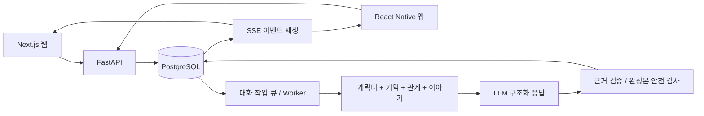

> 2026-10-15: 포트폴리오를 [원본 저장소](../../README.md)에 통합했습니다. 최신 영상, 구현과 검증 자료는 원본 README를 기준으로 확인해 주세요. 아래는 기존 소개 문서입니다.

# 테일비 Talevi

**취향이 되는 첫 대화, 다음 만남까지 이어지는 기억.**

테일비는 캐릭터와 나눈 말이 다음 이야기와 관계에 이어지는 한국어 AI 캐릭터 채팅 서비스입니다. 첫 장면을 고르는 탐색 화면부터, 수정할 수 있는 기억과 대화의 근거를 보여 주는 관계 화면까지 웹과 앱으로 구현했습니다.

Next.js · React Native / Expo · FastAPI · PostgreSQL · OpenAI

[기술 설계와 문제 해결](ENGINEERING.md) | [30명 검증 결과](VALIDATION.md) | [공개 범위와 권리](../../RIGHTS.md)

> 로컬에서 실제 모델로 동작하는 개발 프로젝트입니다. 공개 서비스 배포와 상용 결제 개통은 보류한 상태입니다. 전체 구현과 과거 평가 원문은 이 저장소에서 함께 공개합니다.

## 어떤 대화를 만들고 있나요?

“내가 좋아하는 음료를 기억해 주는 대화”에서 시작해, “함께 고른 선택 때문에 다음 장면이 달라지는 대화”를 목표로 합니다. 캐릭터는 외모와 직업뿐 아니라 말의 길이, 감정에 반응하는 방식, 자기 판단과 망설임을 다르게 갖습니다.

| 경험 | 구현한 기능 |
| --- | --- |
| 취향에 맞는 첫 만남 | 성별, 그림체, 장르 필터와 검색, 책갈피, 첫 장면 미리보기 |
| 서로 다른 30명의 인물 | 여성 15명 / 남성 15명, 반실사 15명 / 애니메이션 15명, 모두 성인인 가상의 인물 |
| 내가 고칠 수 있는 기억 | 이름, 분류별 취향, 약속을 저장하고 직접 수정, 잠금, 삭제 |
| 이유가 보이는 관계 변화 | 협력과 자기 공개, 갈등과 화해의 발언 근거를 관계 화면에 표시 |
| 앞선 선택을 잇는 이야기 | 현재 목표와 갈등, 선택, 결과, 미해결 사건을 다음 답변에 반영 |
| 대화를 계속하는 흐름 | 짧은 대화 / 이야기 모드, 답변 전달 상태, SSE 재연결, 실패 시 크레딧 환급 |

## 화면으로 보는 서비스

### 1. 얼굴에서 시작해 이야기로 고르기

캐릭터마다 표정과 실루엣, 의상, 배경을 구분하고 카드에 첫 대화의 분위기를 담았습니다. 원하는 장르와 그림체를 함께 좁힐 수 있습니다.

### 2. 첫 메시지 앞에서 망설이지 않도록

인물의 소개와 이야기의 첫 문장을 먼저 보여 줍니다. 장면 안에서 바로 대화를 시작할 수 있도록 구성했습니다.

### 3. 이름을 바꿔도 함께 하던 일은 그대로

아래는 합성 테스트 대화입니다. 기억 노트의 이름을 `여름`에서 `가을`로 바꾼 뒤에도 음료 취향과 함께 하던 게임기 점검을 유지했습니다. 관계 패널에는 협력한 발언과 현재 목표를 표시합니다.

### 4. 작은 화면에서도 이어지는 탐색과 관계

<table>
  <tr>
    <td align="center"></td>
    <td align="center"></td>
  </tr>
  <tr><td align="center">캐릭터 탐색</td><td align="center">우리 사이와 이야기</td></tr>
</table>

캡처는 실제 로컬 웹 화면입니다. 탐색과 미리보기는 2026-10-12, 남성 목록과 모바일 탐색은 2026-10-09, 대화와 관계 화면은 2026-10-10 검증 기록입니다. 모바일 이미지는 반응형 웹이며 React Native 실기기 캡처가 아닙니다.

## 구현에서 중요하게 다룬 문제

**기억 수정이 다른 이야기를 지우지 않도록 했습니다.** 과거 메시지를 전부 버리는 대신 AI가 읽는 문맥에서 수정한 사실만 무효화합니다. 원본 대화와 무관한 약속을 보존하고, 성공한 답변에서 확인한 사실만 저장합니다.

**관계 점수에 대화의 근거를 남겼습니다.** 메시지 수나 결제액이 친밀도를 올리지 않습니다. 협력, 자기 공개, 갈등과 화해를 구별하고 반복 입력을 제외합니다. 캐릭터마다 신뢰가 쌓인 뒤 드러내는 약점과 부탁도 다르게 설정했습니다.

**중간에 끊기는 답변과 실패 비용을 함께 다뤘습니다.** 완성된 응답을 검수한 뒤 SSE로 전달하고, 요청 중복과 연결 재개를 처리합니다. 실패한 생성은 원장 기준으로 환급하며, 답변과 기억 및 관계 상태는 성공한 턴에서 함께 저장합니다.

## 서비스 구조

| 영역 | 기술과 역할 |
| --- | --- |
| 웹 | Next.js App Router, React, TypeScript. 탐색부터 대화와 기억 관리까지 |
| 앱 | React Native, Expo. 공통 API 계약, 보안 세션 저장, SSE 수신 |
| 서버 | FastAPI, 비동기 SQLAlchemy. 인증, 대화, 기억, 작업 처리, 원장 |
| 데이터 | PostgreSQL, Alembic. 트랜잭션, 작업 선점, 이벤트 재생 |
| AI | OpenAI Responses. 캐릭터 문맥, 구조화 응답, 모델 대체와 평가 |
| 결제 | Toss Payments / RevenueCat 연동 코드. 실제 거래와 스토어 검증은 별도 |

현재 한국어를 지원하며 locale과 공통 계약을 분리해 다국어 확장을 준비했습니다. 다른 언어의 UI와 모델 품질 평가는 아직 구현 범위에 포함하지 않았습니다.

## 검증으로 확인한 것

2026-10-10의 최종 대화 엔진으로 수행한 합성 입력 검사입니다. 실제 이용자의 만족도나 경쟁 서비스 대비 승률이 아닙니다.

| 검사 | 결과 |
| --- | --- |
| 30명 기본 응답 | 240/240 완료 |
| 30명 각각 30턴 연속 대화 | 900/900 완료 |
| 압축 후 정정된 5개 사실 회상 | 30명 전원 회상 |
| 첫 만남 / 깊은 신뢰의 상태별 응답 | 60/60 완료 |
| 추가 검사를 포함한 완료 응답 | 1,256건 |
| API 회귀 테스트 | 61개 통과 |
| 웹 / 앱 정적 검사와 빌드 | TypeScript, Next.js 빌드, Expo iOS/Android export 통과 |

평가 중 압축 요청의 시간 초과가 한 번 발생해 저장된 결과를 보존하고 재개했습니다. 완료 응답 수를 전체 API 호출의 무장애율로 해석하지 않습니다. 관계 단계 검사는 상태를 직접 넣은 비교이며, 30턴 동안 자연스럽게 깊은 관계에 도달했다는 뜻도 아닙니다.

첫 답변 표시 중앙값은 짧은 대화 **3.74초**, 이야기 모드 **10.27초**였습니다. 완성본 검수가 지연을 늘리는 만큼, 품질을 유지하며 대기 시간을 줄이는 것이 다음 과제입니다. 측정 범위와 캐릭터별 결과는 [검증 문서](VALIDATION.md)에 정리했습니다.

## 프로젝트 범위와 다음 과제

서비스 기획, 화면과 로고, 캐릭터 설정, 웹/앱/API 구현, 모델 프롬프트와 평가, 기억과 관계 시스템을 함께 다룬 프로젝트입니다. 개발과 이미지 제작에 AI 도구를 활용했으며, 자동 생성 결과는 코드 검사와 실제 대화 검증을 거쳐 수정했습니다.

현재는 로컬에서 동작하는 제품입니다. 독립적인 이용자 평가, 경쟁 서비스와의 동일 조건 비교, 수개월 대화, 운영 부하, 모바일 실기기, 결제사 실제 거래 검증은 남아 있습니다. 이메일 확인과 비밀번호 복구도 출시 전 과제입니다.

## 채용 검토 안내

이 공개 자료로 제품 흐름과 기술적 판단, 검증 결과를 먼저 살펴볼 수 있습니다. 구현은 [전체 소스](../../README.md#코드와-개발-문서), 과거 유료 검증은 [자료 색인](../MODEL-EVALUATION-ARCHIVE.md)에서 확인할 수 있습니다.

전체 소스와 원본 캐릭터 프롬프트는 이 저장소에서 공개합니다. 인증 정보와 로컬 데이터는 공개 자료에 포함하지 않습니다. 공개 문서와 스크린샷의 열람은 환영하며, 재사용 범위는 [권리 안내](../../RIGHTS.md)를 확인해 주세요.
